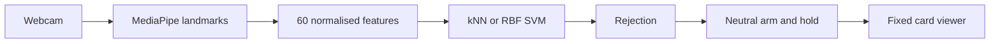

<div align="center">

# GestureForge

### Personal gesture recognition for deliberate card navigation and demo control

**ICT304 Assignment 1 submitted** · **Final project in progress** · Python 3.11

[Run the app](#run-the-prototype) · [Project build](#project-build) · [Results](docs/evidence/RESULTS.md) · [Trello board](https://trello.com/b/wDb978u6/gestureforge-assignment-and-project)

</div>


GestureForge recognises four personally enrolled static hand poses using webcam landmarks and compares **kNN with RBF SVM**. A hold-and-rearm controller turns a deliberate NEXT pose into one card advance. Processing stays on the computer; normal use does not record camera images or video.

The assignment controls its own supplied ten-card deck. **It is not connected to PowerPoint.**

| Gesture | Assignment behaviour |
| :--- | :--- |
| NEUTRAL | Arms control after a stable hold and rearms between commands |
| NEXT | Advances one card per continuous hold |
| PREVIOUS / BOOKMARK | Recognition preview only; no viewer action |
| Unrecognised pose | No command; brief transitions preserve readiness, persistent rejection requires NEUTRAL |
| Invalid or lost hand | No command; show NEUTRAL again |

## Project build

The final project is now scoped as **GestureForge Studio** for corporate training and product demonstrations. It extends the submitted assignment with personal profiles, three mapped gesture actions, Quick Actions for local resources, a validated demo deck/runbook, session review and full evaluation. Contextual AI assistance was removed from scope; the AI subsystem remains personal kNN/SVM gesture recognition.

Current project foundation on `main`:

Manual validation is assigned in the updated [Hau Jie brief](docs/project/HAU_JIE_HANDOFF.md)
and [Javier brief](docs/project/JAVIER_HANDOFF.md): profile/Practice evidence for Hau
Jie, and Harbor/Windows recovery plus fresh-install/offline/stability checks for
Javier. Deston retains design, integration and acceptance review. Both teammates
push only their own branches and leave PRs for review.

The [paired evaluation tool](docs/project/PAIRED_EVALUATION.md) freezes development
inputs/settings, then compares starter and personal recognisers on identical
held-out positive TEST trials. The collector supports separate TEST manifests
with a declared pose ID. This prepares GF-P18; real independent-participant results
and live false-action testing remain outstanding.

Practice recovers from a late camera frame while waiting for **Begin**: it keeps
the completed windows, leaves capture running and asks for a fresh NEUTRAL hold.
The five-second measurement and 200 ms timing checks remain unchanged. See the
[Practice guide](docs/USER_GUIDE.md) for recovery and saved-result instructions.

A late frame during measurement now makes that window **inconclusive** while
the same 50-window session continues. Earlier results are retained. No late
frame can trigger an action, and an inconclusive window prevents a full pass.

Practice now waits up to two seconds for a fresh frame after **Begin**, and a
30-second setup timeout offers **Retry setup** for the same prompt without
ending the session. Setup retries are saved separately from scored windows.
The compact Practice controls keep the next action visible; **Review negative
cues** opens the editable instructions in a separate dialog.

A [capture stability diagnostic](docs/USER_GUIDE.md#capture-stability-diagnostic)
now checks the existing camera pipeline, optional classifier, frame timing,
memory and shutdown without asking for a pose sequence. It stores one compact
local JSON report, with no images or per-frame recording. This prepares the
release tests; it does not establish a full Studio or recognition pass.

| Area | Status |
| :--- | :--- |
| Shared routing contract | Version-1 design frozen and independently reviewed: Try Now, optional Personalise, one action per slot and explicit context activation; implemented routing preserves stale-event and hold/rearm protection |
| Custom gesture vocabulary | PR #10 merged: schema-2 collection, kNN/SVM training and evaluation support three custom action IDs plus NEUTRAL; legacy datasets remain supported |
| Standard gesture integration | Approved-release loader and separate six-action readiness gate implemented; camera/model/binding changes invalidate eligibility. No qualifying redistributable starter is supplied; personal profiles and manual controls remain available |
| Starter feasibility | Hau Jie's [three-person baseline](docs/project/STARTER_EVALUATION_CHECKPOINT.md) and supplied [bounded comparison](docs/project/GF_P11_BOUNDED_COMPARISON.md) identify no qualifying starter; PR #19 was reviewed and repaired without changing those supplied private results |
| Saved profiles | PR #17's selector is attached in Studio's **Profiles** tab: create/load/rename/delete, background reconstruction and non-destructive Guest/manual switching use the reviewed PR #14 persistence; [selector handoff](docs/project/PROFILE_SELECTOR_HANDOFF.md). Loading stays paused and does not pass readiness; standard gestures remain unavailable |
| Guided enrolment | Studio's Enrolment tab collects numeric samples through the shared camera, with consent, timed trials, invalid-sample feedback and save retry; GF-P07 is accepted from attributed P02 collection evidence plus a reviewed generated UI workflow; later participant evaluation remains ([handoff](docs/project/ENROLMENT_INTERFACE_PROPOSAL.md)) |
| Team handoff | Published in `docs/project/TEAM_GUIDE.md`, `HAU_JIE_HANDOFF.md` and `JAVIER_HANDOFF.md` |
| Demo scenario | Authored in `docs/project/DEMO_SCENARIO.md` with `assets/corporate_demo_deck.json` and `assets/corporate_reference.txt` |
| Studio modes | Preview/Rehearsal simulate typed actions; explicitly selected LIVE enables manual actions without a model. Personal LIVE gestures require a current full-Practice grant plus explicit Apply/Start/NEUTRAL |
| Manual card browser | In explicit LIVE mode, Previous, Next and Bookmark act on the deck without a dataset; bookmark review/removal remain available |
| Deck loading and progress | Load validated JSON decks; explicitly save/restore position and bookmarks for the matching deck; control stays paused and failed loads preserve the active deck |
| In-app dataset selection | Load or switch an existing personal manifest without restarting; training runs in the background and camera control stays paused |
| Camera selection and recovery | Select a device index in Studio, apply while paused, then explicitly restart after the previous capture worker releases |
| Personal readiness checks | The preliminary six-activation check remains separate from **Practice**: fifty five-second windows use shared capture/controller/dispatcher and save local per-trial results. Only a saved, reconciled full Practice pass in the current app session can grant temporary personal LIVE eligibility; the short check cannot. The Repair pose flow can create a reviewed replacement TRAIN candidate, but actual participant outcomes remain separate |
| Practice review | Session summary shows the latest saved rehearsal, per-pose and coverage counts, and exact event reconciliation. Historical results remain identifiable after summary/profile changes; the complete trial export stays local |
| Windows launch probe | GF-P05 accepted from PR #18's supplied [laptop-A observations and repair rerun](docs/evidence/WINDOWS_RESULTS_2026-10-02.md): visible targets, Camera release/reacquisition and recorded failure/recovery; integrated both-laptop checks remain under GF-P19 |
| Persistent control bar | Studio keeps prediction, rejection/rearm guidance, Start/Pause, controller state, hold progress and active context/gesture meanings visible while setup and deck content scroll |
| Evaluation recording | Opt-in Studio recording of controller-consumed labels/timestamps; local per-session files, annotation required before scoring |
| Controller replay | Offline annotated-trace comparison of the actual protected controller against a naive per-frame baseline; simulation only, with reproducible counts and latency |
| Workflow comparison | Offline comparison of observer-recorded manual/starter/personal runs and hashed session exports; failed/fallback conditions remain visible, with individual paired comparisons and explicit evidence limits ([guide](docs/project/WORKFLOW_COMPARISON.md)) |
| Workspace/runbook in Studio | Load validated workspaces, edit stages, use Runbook Previous/Continue/Finish/action buttons, and save/restore navigation state while camera control stays paused |
| Quick Actions in Studio | Private twelve-target library and three gesture slots; target buttons/tests simulate in Preview/Rehearsal and request real Windows launches in explicit LIVE mode; no deck/runbook required |
| Session summary | Studio records simulations, manual action outcomes, real launch requests/failures and explicit stage completion acknowledgements; a launch request is not task completion |
| Full Studio workflow | Personal LIVE has a full-Practice gate; standard gestures remain unavailable, and real Practice/native acceptance remains outstanding. The private participant baseline is not a distributable starter |

Team branches must stay separate: Hau Jie works on `codex/hau-jie-profiles`, Javier works on `codex/javier-shortcuts`, and Deston reviews and merges approved PRs into `main`.

To inspect the reusable components in their separate developer harness without a webcam or dataset, run `.\.venv\Scripts\python.exe -m gestureforge.javier_preview` (add `--quick-only` for an empty Quick Actions workspace). This developer harness is separate from the Studio shell and never opens applications. See the [component guide](docs/COMPONENT_GUIDE.md) and [integration review](docs/project/JAVIER_DELIVERY_REVIEW.md).

```powershell
.\run.cmd --studio
# Preview with your own existing local dataset and camera index:
.\run.cmd --studio --dataset data/local/pilot/manifest.json --multiplier 2 --margin 1.5 --camera 1
```

Without a dataset, the manual viewer opens. In Studio, click **Load personal dataset...** and choose your collected `manifest.json`. Loading pauses control and trains locally in the background using the launch settings (`--algorithm`, `--multiplier`, `--margin`). A successful switch keeps a compatible active stage mapped, leaves empty or mismatched stages manual-only, and otherwise keeps the startup deck's default Preview mappings; check the mappings, wait for any previous camera thread to stop, then start explicitly and show NEUTRAL. Failed loads retain the previous selection in a paused state. Numeric gesture data stays local; synthetic fixtures cannot enable camera simulation.

Choose an existing personal TRAIN manifest for gesture loading. If the selected JSON is a workspace or deck, the loader directs you to **Load workspace...** or **Load deck...**. A dataset with no valid TRAIN samples has a separate error; a validation/negative-only manifest cannot train the model. Selecting the wrong file does not require rerecording gestures.

Studio starts in Preview. Typed action buttons simulate in Preview/Rehearsal. In **Studio action mode**, select **Live** and click **Apply and pause** to use manual deck/stage actions and request validated Windows shortcuts; no recogniser or readiness pass is needed for manual actions. Previous-stage navigation, bookmark review/removal, restart and restore remain explicit navigation operations; stage transitions stay paused. macOS keeps the manual viewer available but reports external launches unsupported. Personal gesture control in LIVE requires a current full-Practice grant, explicit LIVE selection and Apply, then Start and fresh NEUTRAL. The short six-activation check never grants that eligibility; no pass starts real actions automatically.

**Delegated acceptance:** after the software fixes and checks, Javier executes the [six-stage Harbor manual walkthrough](docs/project/DEMO_SCENARIO.md#manual-walkthrough-available-now) and Windows recovery/offline checks. Hau Jie checks existing personal data/profile compatibility and focused recognition before full Practice; Deston reviews and integrates their evidence. Harbor needs no webcam or new samples. Target repairs preserve the current stage; failed target tests appear in session results without private paths, and retry is explicit. To transfer this development build, use the [separate Studio source ZIP command](releases/README.md#studio-development-handoff), which preserves the assignment archives.

**Finding manual mode:** click **Open Setup**. **Studio action mode** and **Apply and pause** are at the top of Setup, before dataset, camera and readiness controls. If the panel is scrolled, return to its top. Disabled gesture-readiness controls do not block manual mode.

To collect new data, select the camera index, open **Enrolment**, enter a participant ID, hand, pose descriptions and conditions, and confirm numeric-data consent. Click **Request collection**, wait for the preview, then **Begin trial** for each prompted pose. No existing model is needed. Each session saves beneath ignored `data/local/enrolment/`; no photos or video are saved. TRAIN and VALIDATION use separate session folders. Pause, leaving the tab or losing focus stops collection; a failed write retains the trial for **Retry save**. A completed TRAIN manifest can be explicitly loaded with **Load personal dataset...**. Collection never installs a model or enables gesture actions automatically. See the [collection steps](docs/USER_GUIDE.md#collect-in-studio).

Open **Profiles** to create a personal profile from an existing numeric manifest, load a saved profile, rename it or confirm deletion. Creation requires explicit internal-use permission. Creation/loading runs in the background and stays paused in Preview; **Request Preview start** requires the matching selected model, released camera and a fresh NEUTRAL hold. Competing setup operations are blocked while busy. **Use Guest (manual only)** unloads the recogniser without deleting saved profiles or source data. Standard gestures remain unavailable, and loading never establishes readiness. See the [profile handoff](docs/project/PROFILE_SELECTOR_HANDOFF.md).

Use **Repair pose** only after a diagnostic identifies one label that needs targeted repair in your own saved profile. The tab uses the installed saved personal profile as its source; Guest/manual mode and ad-hoc manifests cannot be repaired directly. Collect 2-12 trials for the chosen label through the shared observation-only capture, review the counts, then save a separate TRAIN candidate that preserves the other classes plus original-dataset and reviewed-collection hash checks. The candidate opens in **Profiles** for explicit permission and **Create and load personal profile**; loading stays paused in Preview and expires readiness. Roll back by loading the original saved profile. See the [repair handoff](docs/project/SELECTED_POSE_REPAIR_HANDOFF.md).

An existing saved profile can also launch with `.\run.cmd --studio --profile-id YOUR_PROFILE_ID --camera 1`. The private store defaults to `.local/profiles`; `--profile-store PATH` selects the store for both startup and the Profiles tab. Use the JSON filename without `.json` as the ID. Its saved classifier settings are authoritative, so do not also pass dataset/algorithm/multiplier/margin arguments. A successful load shows the profile name and stays paused with readiness unverified.

Open **Practice** with your personal recogniser loaded to run the longer measured rehearsal. Review the ten editable negative/transition cues, select **Save local numeric rehearsal outcomes for this profile**, then **Start personal practice**. Use **Prepare next trial**, wait for capture and the requested NEUTRAL arming, then **Begin five-second window**. There are ten windows per enrolled action pose and NEUTRAL, followed by ten negative windows. Actions simulate through the existing dispatcher; no external resource opens. Results save beneath ignored `.local/studio/practice/`. Stop, focus loss or leaving the tab ends the attempt and restores the previous context paused after saving. See [Practice steps and save recovery](docs/USER_GUIDE.md#personal-practice).

The camera stays fixed while the right workflow pane scrolls. Use **Setup** for camera, mapping, readiness and file controls; **Open Practice** reveals the trial and consent controls directly. After starting Practice, choose the full 50-window rehearsal or **Test only [pose]** for one five-second diagnostic. Stay NEUTRAL through **Begin**, then follow the timed cue. The camera deliberately switches off after each window; **Prepare next trial** reopens it. A diagnostic records its actual outcome without assessing other poses or granting personal LIVE eligibility. New results include frame-gap timing for incomplete capture; completing a command alone does not establish full capture coverage. No recommendation changes a model or enables LIVE gestures.

A genuine full Practice pass in the current app session can grant **personal LIVE eligibility** only after all 50 windows are covered, at least 9/10 trials are correct for every pose including NEUTRAL, there are no wrong activations, and all ten negative windows are correct. The result must be saved, its simulated events reconciled with the session summary, and the previous context restored paused. The grant exists only in memory and covers the current profile/model/hand/camera/behavior revision and exact authored workspace, stage and Quick Actions maps. Behavior, mapping, target or camera edits expire it even if changed back; restarting Studio, Guest and model reload clear it. Cosmetic renames, ordinary pause and selecting an existing configured stage or Quick Actions context retain eligibility, but every resume needs explicit Start and fresh NEUTRAL. Short checks, diagnostics and historical/imported JSON cannot grant it. See [personal LIVE activation](docs/USER_GUIDE.md#personal-live-after-practice).

Use **Camera index** and **Use camera and pause** in Setup to select another webcam without restarting the application (usually 0 or 1). Changing the applied camera expires any personal LIVE grant. To continue simulation, select Preview or Rehearsal and click **Apply and pause**; LIVE camera Start requires a new qualifying full Practice pass. With a personal recogniser loaded and the old camera released, click Start and show NEUTRAL. A failed or disconnected camera clears its old preview and shows recovery guidance; manual controls stay available. The on-screen hint shows the platform-native shortcuts for loading a dataset and starting capture (**Ctrl+O/Ctrl+Enter** on Windows); **Esc** pauses. Setup contains the training indicator; camera changes are disabled during that job.

Studio pauses capture on focus loss; resume explicitly. Select rehearsal at launch with `--studio-mode rehearsal`. Use the Studio mode and mapping controls, then apply the change explicitly. Draft edits do not change active control. Applying stops capture and requires explicit Start and a new NEUTRAL hold before gesture control resumes. Editing action meanings expires the personal LIVE grant even if the previous values are restored. These ad-hoc mappings are temporary and are not saved; Quick Actions target/slot settings are saved separately on this computer. Stage changes never launch a target automatically. Default launch without `--studio` preserves assignment behaviour.

After an action, **LATCHED** means another action is blocked until the recogniser accepts a steady NEUTRAL hold. Studio now keeps the current prediction and rejection explanation visible beside the controls; the bar waits at zero until accepted NEUTRAL starts rearming. See [rearming diagnostics](docs/USER_GUIDE.md#studio-stays-latched-with-an-open-palm) if an open palm does not reach READY. The reported intermittent recognition issue still needs a recorded reproduction; the feedback fix does not establish improved recognition accuracy.

Use **Quick Actions** to create or edit a local target, choose its slot, then click **Use Quick Actions**. It works without loading a deck/runbook. Target edits pause and clear active gesture bindings; gesture simulation requires explicit Start plus NEUTRAL after activation. Slot buttons and **Test selected target** follow the current mode: simulated in Preview/Rehearsal, real Windows launch requests in explicit LIVE. Camera launch waits for capture release; return and resume are manual. The private target library and slots reload from `.local/studio/quick-actions-targets.json`; they are not included in workspace/session exports. See the [user guide](docs/USER_GUIDE.md#final-project-preview) for the steps.

Use **Manual browse / bookmarks** beside the Card tab. Its Previous, Next and Bookmark actions change the deck in explicit LIVE mode and simulate in Preview/Rehearsal. Double-click a bookmark, or select it and press Enter, to revisit its card. Select a bookmark before removing it. Both tabs share the same deck.

The **Setup** tab includes **Load deck...**, **Save progress...**, **Restore progress...**, **Load workspace...**, **Save session...** and **Restore session...**. **Load deck...** accepts the supplied `assets/corporate_demo_deck.json` or your own validated deck JSON. **Save progress...** writes the current position and bookmarks, with an ignored local folder suggested. **Restore progress...** restores them only for the matching loaded deck and stays paused. Load the same deck first after reopening the app; the progress file does not contain the deck itself. Restart deck keeps the current deck, returns to its first card and clears bookmarks in memory.

Use **Load workspace...** for a validated workspace JSON such as `assets/harbor_workspace.json`. A custom deck load creates a manual deck workspace and detaches any previous runbook. The **Runbook** tab exposes manual Previous, Continue/Finish and stage action buttons. Typed actions simulate in Preview/Rehearsal; explicit LIVE permits manual stage actions, including validated Windows launch requests. **Save session...** writes the current workspace, runbook stage/finished state and deck position/bookmarks. Before **Restore session...**, load the same workspace first; restore validates that match, restores paused and does not auto-detect a workspace from the session file. If a stage uses gesture IDs outside the loaded vocabulary, Studio keeps that stage manual-only; loading a compatible model reapplies the current stage bindings. Loading or restoring never replays a launch or enables live gestures.

Use **Edit runbook** to create, save, delete or reorder authored stages; accepted edits reset the current workspace/runbook while preserving deck review state when the deck is unchanged. Use **Session summary** to refresh counts and **Export session results** to write a local JSON measurement archive. Counts cover Studio manual card/runbook/Quick Actions outcomes plus simulated and eligible LIVE gesture outcomes/rejections; zero trial counts mean no measured trials were recorded in that summary. Before deck/workspace replacement, session restore, restart or close would leave a non-empty summary behind, Studio archives it under ignored `.local/studio`; if archiving fails, the change or close is blocked and counts stay visible. Successful restore/restart starts a fresh review summary. Summary exports are separate from **Save session...** / **Restore session...**, which save runbook navigation state explicitly; position is not autosaved.

[Approved plan](docs/project/PROJECT_PLAN.md) · [Progress](docs/project/PROGRESS.md) · [Team guide](docs/project/TEAM_GUIDE.md) · [Hau Jie brief](docs/project/HAU_JIE_HANDOFF.md) · [Javier brief](docs/project/JAVIER_HANDOFF.md) · [Scenario and evaluation protocol](docs/project/DEMO_SCENARIO.md)

Studio also accepts personal schema-2 datasets collected with `python -m gestureforge.collect --vocabulary PATH` (see the [vocabulary format and collection handoff](docs/project/HAU_JIE_GF_P03_REVIEW.md)). The dataset's three action IDs appear in the mapping controls, initially mapped in order to Next, Previous and Bookmark simulations. Only enrolled IDs can be mapped. Custom datasets require `--studio`; the assignment viewer retains its legacy labels. Studio binds predictions to a model revision derived from the training data and settings. These software checks do not establish recognition quality for new poses or users.

Verify the project without overwriting historical assignment evidence:

```powershell
.\.venv\Scripts\python.exe scripts/verify.py --output docs/project/verification.json --synthetic-output experiments/local/project-software-check.json
```

[Current project checks](docs/project/verification.json) record software evidence. They do not establish live-camera performance or completion of remaining features.

For the controller evaluation, use `scripts/replay_controller.py --trace PATH --output PATH` with the environment's Python. The [evaluation guide](docs/project/DEMO_SCENARIO.md#controller-replay-tool-gf-p20-preparation) defines the trace/annotation format and scoring. In Studio, opt into **Record evaluation trace** before Start, then Pause to save a local unannotated trace. The guide explains independent annotation before scoring. Existing command-only logs cannot replace full prediction traces. This tool prepares the final evaluation; real participant collection and workflow comparisons remain outstanding.

## Run the prototype

Initial installation needs internet. Clone the repository or extract a fresh source ZIP; create the Python environment on the computer that will run the app. On Windows, use the [runtime-path recovery instructions](docs/WINDOWS_LAPTOP.md#2-install-python-and-dependencies) if MediaPipe reports an inaccessible non-ASCII path; do not copy `.venv` between computers.

### Windows

Use **64-bit Python 3.11 on an Intel/AMD laptop**.

Extract the source ZIP or clone this repository, then open PowerShell in its folder:

```powershell
.\setup.cmd
.\run.cmd
```

This opens the keyboard-only viewer. **A connected webcam does not enable Start camera control until a personal dataset is loaded.** Use the Next card button or Right arrow to try the deck without a camera.

For the enrolled P01 user on the development computer:

```powershell
.\.venv\Scripts\python.exe scripts/check_environment.py --camera --camera-index 1
.\run.cmd --dataset data/local/pilot/manifest.json --algorithm knn --multiplier 2 --margin 1.5 --camera 1
```

### Apple Silicon Mac

Use **macOS 13+ and native Python 3.11 (`arm64`)**. Open Terminal in the project folder:

```bash
python3.11 scripts/setup_macos.py
bash run.sh
```

Setup installs the pinned dependencies, verifies the hand model and briefly opens both GUI modes to check startup. Run `bash run.sh --studio` for the project preview. Do not copy a Windows `.venv` or run Python through Rosetta. See the [Mac guide](docs/MACOS.md) for Python installation, camera permissions and personal gesture collection.

After collecting your own dataset in `data/local/mac-pilot`, check the camera and launch gesture control:

```bash
.venv/bin/python scripts/check_environment.py --camera --camera-index 0
bash run.sh --dataset data/local/mac-pilot/manifest.json --algorithm knn --multiplier 2 --margin 1.5 --camera 0
```

Allow camera access for the launching application when macOS asks. Without a personal dataset, the viewer opens with keyboard/mouse controls and camera control stays disabled.

All 41 pinned packages resolved for Apple Silicon/Python 3.11 in the [refreshed 1 October check](docs/project/macos-compatibility.json). Studio uses native keyboard shortcut labels; desktop shortcut launches are Windows-specific, while the Mac target covers the manual viewer, personal classifier and gesture simulation. Unsupported external launches report a reason. The [current project checks](docs/project/verification.json) record the Windows test, lint, type-checking, GUI-smoke and synthetic-evaluation results. **Actual Mac installation, live camera operation and smoothness still need confirmation on a Mac**; dependency resolution alone does not verify those behaviours. Intel Macs are outside this setup path.

### Use gesture control

Camera indices can change. Close other camera applications and select the index that works on your computer. The source repository excludes P01's private samples; use the authorised private marker ZIP to reproduce P01, or follow the [collection instructions](docs/DATA_COLLECTION.md) to enrol your own hand in a separate folder. Never overwrite the retained P01 dataset.

1. Click **Start camera control** and show the enrolled NEUTRAL pose until READY.
2. Hold the enrolled NEXT pose until the card changes. Continuing to hold must not advance again.
3. Return to NEUTRAL before the next command.
4. Press **Esc** or **Pause / camera off** to stop gesture control. Manual controls remain available.

For P01, NEUTRAL was an open palm and NEXT was a fist. Another person's gestures must match their own collection. Keep the whole enrolled hand visible, still and similarly oriented to the training samples.

[Full user guide](docs/USER_GUIDE.md) · [Second Windows laptop setup](docs/WINDOWS_LAPTOP.md) · [Apple Silicon Mac setup](docs/MACOS.md)

## How it works



MediaPipe supplies 21 hand landmarks. The project's work is the feature pipeline, personal classifier fitting and comparison, rejection calibration, controller and application integration. Wrist-relative world landmarks are scaled by wrist-to-middle-knuckle distance. The scaler is fitted only to TRAIN data. Entire trials remain within one recording split.

Camera inference runs outside the UI thread with one latest-result mailbox. No hand, multiple hands, the wrong hand, invalid features and rejected predictions cannot dispatch a command. A held gesture fires once, and neutral is required before another action. The model is rebuilt from numeric arrays and JSON rather than loaded from executable pickle files.

## Results and limits

The recommended live setting is **prototype-v3**, multiplier **2.0**, ambiguity margin **1.5**. The comparison below uses the same saved P01 development sessions:

| Setting | kNN / SVM trial macro-F1 | Correct trials | Unfamiliar samples accepted as command labels |
| :--- | ---: | ---: | ---: |
| Historical distance-only v2 | 0.9686 / 0.9686 | 31 / 32 | 25 / 40 |
| Recommended v3 with ambiguity rejection | 0.9667 / 0.9667 | 30 / 32 | 5 / 40 |

The improved model rejects 25/40 unfamiliar samples as UNKNOWN; 5 are still accepted as BOOKMARK and 10 as NEUTRAL. Two genuine trials become UNKNOWN (one NEXT, one NEUTRAL), and no validation trial is assigned to the wrong known class. This is an observed trade-off, not a perfect unknown detector. The user confirmed two NEUTRAL-to-NEXT transitions each advanced once after the controller correction. Broader live evaluation remains pending.

One consenting participant supplied 160 training and 160 validation samples in separate sessions, plus 40 unfamiliar-pose samples. These are **development-validation results**, not untouched test results or performance on unenrolled people. Timing and per-class results are in the [consolidated evidence](docs/evidence/RESULTS.md).

Unfamiliar gestures should display **Unrecognised**. PREVIOUS and BOOKMARK are not fallback labels. However, a classifier can mistake an unfamiliar pose for a known pose: the historical model accepted 25/40 negative samples as BOOKMARK and 10/40 as NEUTRAL. Zero NEXT predictions in those samples does not prove zero live false actions. The v3 comparison above records the improvement separately from this historical baseline.

P01 confirmed two held NEXT gestures each advanced once after neutral rearming. P02 reported successful assisted ZIP use on another laptop, NEXT traversal from card 1 to 10, and one action during a five-second hold. On 29 September the user also confirmed that second-laptop offline operation and camera pause/restart checks passed. These are user-reported results; the exact release/environment and an unaided guide-only installation remain undocumented. Orientation, movement, framing and distance remain limitations.

## Verify and reproduce

```powershell
# Automated tests, lint, type checks, GUI smoke and synthetic software checks
.\.venv\Scripts\python.exe scripts/verify.py --output docs/project/verification.json --synthetic-output experiments/local/project-software-check.json

# Reproduce the recommended v3 comparison from the private P01 package
.\.venv\Scripts\python.exe -m gestureforge.evaluate --config experiments/pilot-rejection.json --output experiments/local/reproduced-pilot-v3.json

# Historical v2 comparison remains reproducible
.\.venv\Scripts\python.exe -m gestureforge.evaluate --config experiments/pilot.json --output experiments/local/reproduced-pilot.json
```

CI runs locally with `scripts/verify.py`; release scripts produce the transferable ZIPs. GitHub Actions is disabled while hosted usage is unavailable, and the workflow is retained for manual use only. No deployment service is required for this desktop app.

[Recorded software checks](docs/evidence/verification.json) distinguish automated verification from live hardware evidence. Synthetic fixtures test the software; they are not human recognition results.

## Submission map

| What the marker needs | Location |
| :--- | :--- |
| Problem, requirements, lifecycle, architecture, technique investigation and results | Local `GestureForge_TechnicalReport_Updated.docx`, submitted separately |
| Requirement to test mapping and planned full-system evaluation | [Test plan](docs/TEST_PLAN.md) |
| Measured pilot and qualitative hardware/laptop evidence | [Results](docs/evidence/RESULTS.md) |
| Installation, operation and data protocol | [User guide](docs/USER_GUIDE.md), [Windows guide](docs/WINDOWS_LAPTOP.md), [collection protocol](docs/DATA_COLLECTION.md) |
| AI assistance declaration and recorded prompts | Local `submission/Prompt_Log.docx`, submitted separately |
| Decisions, alternatives, risks and scope boundaries | Local `submission/Decision_Log.docx`, submitted separately |
| Agile tools and progress | [Agile record](docs/AGILE.md), [backlog snapshot](docs/backlog.csv) |
| Tools record and required declaration | [Tools and coordination](docs/CONTRIBUTIONS.md); local `groupDeclarationSheet.docx`, submitted separately |
| Dependencies, sources and reproducibility | [Licences and references](LICENSES.md), [requirements.lock](requirements.lock), [model manifest](assets/model_manifest.json) |

The technical report, `Prompt_Log.docx`, `Decision_Log.docx` and completed declaration are private deliverables maintained outside this repository in the assignment's `submission/` folder. They are excluded from GitHub and both code ZIPs. Submit the reviewed Word deliverables and completed declaration alongside the code.

**Before submission:** confirm same-tutorial/team registration, review the AI disclosure and separate local logs, and verify the exact upload package. Page 1 of the course brief asks for prompts in the report; this assignment keeps them in a separate Word log at the user's request, and acceptance of that arrangement has not been confirmed. Keep personal details and authorised participant data in the private LMS submission, then download and verify the uploaded files.

In explicit LIVE mode, Studio's manual Bookmark control marks the current card for later review, with bookmarks saved and restored with deck progress. Repeating it keeps one bookmark and does not advance the card. Preview/Rehearsal simulate the request. An eligible personal Studio gesture can perform BOOKMARK after explicit LIVE activation; the assignment entry point displays recognition only.

## Assignment and project boundary

| Assignment due 3 October 2026 | Project extension due 7 November 2026 |
| :--- | :--- |
| Command-line personal collection | In-app enrolment and practice |
| Four labels with NEXT execution | PREVIOUS and BOOKMARK execution |
| Fixed supplied deck | Validated custom JSON decks |
| Local numeric dataset and configuration | Multiple profile creation, reload and deletion |
| Preliminary comparison and controller tests | Saved deck state and bookmarks; held-out two-profile and full-system evaluation |

Dynamic gestures, sign-language translation, two-handed commands, direct PowerPoint control, arbitrary OS scripting, background control, cloud accounts, mobile apps and an installer are outside the committed scope. The expanded project includes bounded user-configured desktop shortcuts; these are planned separately from the submitted assignment.

## Repository layout

```text
gestureforge/       Application and AI subsystem
tests/              Automated regression checks
assets/             Supplied deck and model provenance
experiments/        Reproducible configurations
scripts/            Setup, verification and packaging
docs/               Guides, traceability and evidence
```

Private data, environments, generated ZIPs and local working archives are ignored by Git. Redundant drafts, older PDFs and internal checklists are retained locally rather than included in the graded source. See [release instructions](releases/README.md) for the source and authorised private marker packages.

Team identities and agreed contributions are recorded in the separate local report and declaration. Codex assisted planning, code, tests, documentation and troubleshooting; the team remains responsible for understanding and checking the submitted work. MediaPipe, OpenCV, PySide6, NumPy and scikit-learn are credited in the licence record.
