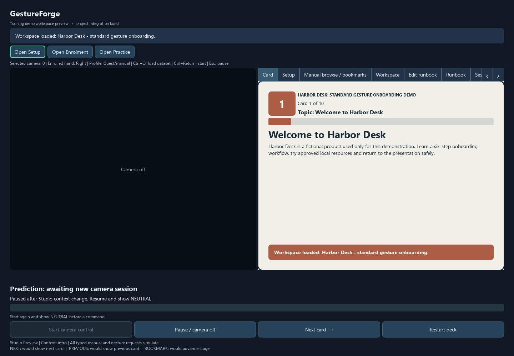
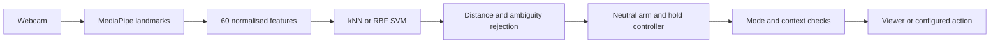

<div align="center">

# GestureForge

### Keep the demonstration moving.

Personal gesture controls for training, product demonstrations and desktop workflows.

**Local processing** · **Personal profiles** · **Deliberate activation** · **Python 3.11**

[Repository](https://github.com/Chi944/GestureForge) · [Quick start](#quick-start) · [How it works](#how-it-works) · [Results](#results-and-release-scope) · [User guide](docs/USER_GUIDE.md) · [Trello](https://trello.com/b/wDb978u6)

</div>

A demonstration often involves more than advancing slides: opening a reference,
launching a calculator, following a sequence and recovering your place after an
interruption. GestureForge brings those steps into a reusable **workspace and
runbook**, with personal hand gestures alongside buttons and keyboard controls.

Show NEUTRAL to arm control, hold an action pose to trigger once, then return to
NEUTRAL before the next action. The visible state explains what Studio is waiting
for. Processing stays on your computer; ordinary use does not save photos or video.



*Actual Studio interface, shown without a camera or personal dataset loaded.*

## What you can do

| Feature | In Studio |
| :--- | :--- |
| Personal profiles | Enrol three action poses and NEUTRAL; create, load, rename or delete local profiles |
| Practice and readiness | Test gestures in simulation, inspect outcomes and deliberately enable Live control |
| Cards and bookmarks | Navigate a JSON card deck, bookmark useful cards and save your position |
| Workspaces and runbooks | Prepare a sequence of resources and show the action assigned to each gesture |
| Windows Quick Actions | Request a configured app, file, folder or website; distinguish a launch request from completed work |
| Recovery and review | Pause, restore saved progress without replaying actions, inspect failures and retry explicitly |

**GestureForge controls its own viewer and configured resources; it is not
connected to Microsoft PowerPoint.** It is designed for prepared demonstrations,
not background computer control or arbitrary command execution. A clicker may be
simpler for slide-only navigation. The [research review](docs/project/RESEARCH_POSITIONING_2026_10_23.md)
explains this positioning and the limits of the proposed benefit.

## Quick start

### Windows

Use Windows 10/11 on an Intel/AMD computer with **64-bit Python 3.11**.
Extract the source ZIP or clone the repository, then open PowerShell in its folder:

```powershell
.\setup.cmd
.\run-studio.cmd
```

Setup installs the pinned dependencies and prepares the hand-landmark asset.
After setup, double-click **run-studio.cmd** to reopen Studio. The source package
is not a standalone executable; setup is required. See the
[Windows setup guide](docs/WINDOWS_LAPTOP.md).

1. **Explore without a camera.** Guest/manual mode lets you inspect the supplied
   workspace. Preview simulates requests. Choose Live and **Apply and pause**
   when you intend to use real manual actions.
2. **Create your profile.** Choose **Open Enrolment → Request collection**, or
   load an existing personal profile. **Start camera control** requires a loaded
   recogniser; it is not the enrolment button.
3. **Select the camera.** In Setup, choose **Camera index → Use camera and pause**.
   Index 0 is usually the first camera; try 1 for another device. Close other apps
   using it. A deck/workspace JSON is not a gesture dataset.
4. **Practise first.** Review the negative cues and recording consent, then run
   the full 22-window Practice protocol. Capture intentionally releases between
   windows. A short diagnostic does not grant Live eligibility.
5. **Start deliberately.** With a saved full Practice pass in this app session,
   choose Live, apply, start capture and show NEUTRAL until READY. Hold a command
   once and return to NEUTRAL. **Esc** or **Pause / camera off** stops control.

An explicit [manually approved supervised demo](docs/USER_GUIDE.md#manually-approved-demo)
is also available; it does not rewrite saved automated results. A model, camera
or mapping change expires eligibility. Focus loss pauses capture; resume
explicitly. See [Practice instructions](docs/USER_GUIDE.md#personal-practice) and
[recognition troubleshooting](docs/USER_GUIDE.md#studio-shows-unrecognised-for-previous-or-another-pose).

### Apple Silicon Mac — experimental

The setup path targets **macOS 13+ with native arm64 Python 3.11**:

```bash
python3.11 scripts/setup_macos.py
bash run-studio.command
```

Create a fresh Mac environment; do not copy a Windows `.venv`. Allow camera access
for the launching application when requested. External resource launching is
Windows-specific. Intel Macs are outside this setup path.

Dependency resolution has been checked, but **native Mac installation, webcam
operation and smoothness have not been verified on a Mac**. Successful browser
collection on macOS does not establish native Studio compatibility. Read the
[Mac guide](docs/MACOS.md) before using this path.

### Other entry points

- `run.cmd --studio` / `bash run.sh --studio` also launch Studio.
- `run.cmd` / `bash run.sh` open the smaller NEXT-only card viewer.
- [Browser participant kits](docs/project/PARTICIPANT_KITS.md) collect numeric
  gesture data without Python. They are recording tools, not Studio. Participants
  return the generated `EMAIL_THIS_...zip`; nothing uploads automatically.

## How it works



MediaPipe supplies pretrained hand tracking. GestureForge adds wrist-relative
features, personal classifiers, rejection and deliberate command activation.
Scaling is fitted on TRAIN only; all samples from a trial stay in one split.
Models rebuild from numeric arrays and JSON instead of loading executable pickles.

Capture runs outside the UI thread with a latest-result mailbox. Missing,
multiple or wrong hands, invalid features and rejected predictions cannot dispatch
an action. Unknown poses should display **Unrecognised**, but a classifier can
still misclassify a pose. No shared starter model qualified for release; users
must enrol their own profile. Loading or restoring never starts capture or
replays actions automatically.

## Results and release scope

The Windows release candidate has scoped acceptance based on assisted installation,
functional checks, recovery and measured stability. **Guide-only installation and
continuously disconnected laptop-B operation remain unverified.** Native Mac
Studio remains experimental. See the [release acceptance](docs/project/PROJECT_PLAN.md)
and [subsystem evidence](docs/TEST_PLAN.md).

| Evidence | Recorded result | Interpretation |
| :--- | :--- | :--- |
| Software verification, 29 October | **1,238 tests passed; two skipped**, Ruff, both startup checks and synthetic evaluation; corrected type-check follow-up passed | Software checks, not physical recognition performance |
| Held-out P67 trial macro-F1 | Starter **0.769** / personal **0.718** | Personal target of 0.90 not met |
| Held-out P1543 trial macro-F1 | Starter **0.979** / personal **0.397** | Personal target not met; both personal models rejected all NEXT trials |
| P01 visual latency check | **16/20 responses**, four misses; successful-response p95 **0.515–0.718 s** | Excludes misses; does not establish the all-attempt target |
| Laptop-B passive capture | **30 min 35.532 s**, **44,378 observations**, peak **437.21 MiB** | Clean shutdown and camera reuse recorded; not an interactive endurance run |

These findings support a bounded personal demonstration, not universal gesture
reliability or a proven productivity improvement. Training conditions, pose
orientation, movement and framing matter. Manual controls remain available.

Detailed methods and evidence: [paired TEST results](docs/project/GF_P18_TEST_RESULTS_2026_10_14.md),
[profile disposition](docs/project/GF_P21_RELEASE_PROFILE_DISPOSITION_2026_10_26.md),
[workflow and latency evaluation](docs/project/P20_EVALUATION_2026_10_26.md),
[laptop-B stability](docs/project/LAPTOP_B_PASSIVE_STABILITY_2026_10_28.md).
Historical failed results and original saved Practice outcomes are retained.

## Verify and reproduce

From the configured Windows environment:

```powershell
.\.venv\Scripts\python.exe scripts/verify.py --timeout 1200
```

This runs lint, type checks, tests, both startup checks and synthetic evaluation.
It writes a new timestamped receipt under ignored `experiments/local/`; synthetic
results are not participant evidence. Evaluation refuses existing output paths
to preserve recorded results. Developers with Node.js can check browser logic:

```text
node --test tests/participant_collector.test.mjs
```

Private participant data is intentionally absent from GitHub. Reproducing human
results requires the permitted numeric data and frozen configurations supplied
separately to the marker; cloning alone cannot reproduce them. See the
[evaluation protocol](docs/project/PAIRED_EVALUATION.md) and
[release instructions](releases/README.md).

Checks run locally. GitHub Actions is manual-only while hosted usage is unavailable;
this desktop app needs no deployment service.

## Guides and development

| Topic | Documentation |
| :--- | :--- |
| Use and troubleshooting | [User guide](docs/USER_GUIDE.md), [Windows](docs/WINDOWS_LAPTOP.md), [Mac](docs/MACOS.md) |
| Demonstrate the product | [Harbor scenario](docs/project/DEMO_SCENARIO.md), [walkthrough](docs/project/GF_P25_WINDOWS_GUIDE_DRAFT.md), [presentation plan](docs/project/GF_P25_DEMO_STORYBOARD.md) |
| Data and evaluation | [Collection](docs/DATA_COLLECTION.md), [paired evaluation](docs/project/PAIRED_EVALUATION.md), [test plan](docs/TEST_PLAN.md) |
| Architecture | [Components](docs/COMPONENT_GUIDE.md), [contracts](docs/project/CONTRACTS.md) |
| Team coordination | [Team guide](docs/project/TEAM_GUIDE.md), [accepted progress](docs/project/PROGRESS.md), [agile record](docs/AGILE.md) |
| Attribution | [Libraries and references](LICENSES.md), [pinned dependencies](requirements.lock), [model provenance](assets/model_manifest.json) |

```text
gestureforge/       Desktop application and recognition pipeline
participant/        Browser data collector
tests/              Regression checks
assets/             Decks, workspaces and model provenance
experiments/        Reproducible configurations
scripts/            Setup, verification and packaging
docs/               Guides, contracts and evidence
```

Deston leads integration, design and acceptance; Hau Jie develops profiles and
recognition; Javier develops viewer, workspaces and shortcuts. Teammates work on
their own branches and open reviewed pull requests; `main` holds integrated work.
Trello supports planning, Git/GitHub supports version control and collaboration,
and WhatsApp supports communication. Codex assisted development and documentation;
the team reviews and verifies its output.

Private samples, full reports, Word deliverables, environments and generated ZIPs
stay outside version control. Dynamic gestures, sign-language translation,
two-handed commands, arbitrary OS scripting and direct PowerPoint integration
are outside the current scope.
