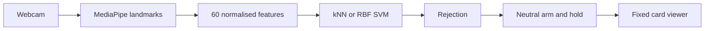

<div align="center">

# GestureForge

### Personal gesture recognition for deliberate card navigation and demo control

**ICT304 Assignment 1 submitted** · **Final project in progress** · Python 3.11

[Run the app](#run-the-prototype) · [Project build](#project-build) · [Results](docs/evidence/RESULTS.md) · [Trello board](https://trello.com/b/wDb978u6/gestureforge-assignment-and-project)

</div>


GestureForge recognises four personally enrolled static hand poses using webcam landmarks and compares **kNN with RBF SVM**. A hold-and-rearm controller turns a deliberate NEXT pose into one card advance. Processing stays on the computer; normal use does not record camera images or video.

The assignment controls its own supplied ten-card deck. **It is not connected to PowerPoint.**

| Gesture | Assignment behaviour |
| :--- | :--- |
| NEUTRAL | Arms control after a stable hold and rearms between commands |
| NEXT | Advances one card per continuous hold |
| PREVIOUS / BOOKMARK | Recognition preview only; no viewer action |
| Unrecognised pose | No command; brief transitions preserve readiness, persistent rejection requires NEUTRAL |
| Invalid or lost hand | No command; show NEUTRAL again |

## Project build

The final project is now scoped as **GestureForge Studio** for corporate training and product demonstrations. It extends the submitted assignment with personal profiles, three mapped gesture actions, Quick Actions for local resources, a validated demo deck/runbook, session review and full evaluation. Contextual AI assistance was removed from scope; the AI subsystem remains personal kNN/SVM gesture recognition.

Current project foundation on `main`:

| Area | Status |
| :--- | :--- |
| Shared routing contract | Implemented and tested in `gestureforge/contracts.py`, `gestureforge/controller.py` and `gestureforge/routing.py` |
| Custom gesture vocabulary | PR #10 merged: schema-2 collection, kNN/SVM training and evaluation support three custom action IDs plus NEUTRAL; legacy datasets remain supported |
| Team handoff | Published in `docs/project/TEAM_GUIDE.md`, `HAU_JIE_HANDOFF.md` and `JAVIER_HANDOFF.md` |
| Demo scenario | Authored in `docs/project/DEMO_SCENARIO.md` with `assets/corporate_demo_deck.json` and `assets/corporate_reference.txt` |
| Studio preview | Opt-in `--studio` simulation; shows would-be actions without executing gesture-driven viewer or desktop actions |
| In-app dataset selection | Load or switch an existing personal manifest without restarting; training runs in the background and camera control stays paused |
| Camera selection and recovery | Select a device index in Studio, apply while paused, then explicitly restart after the previous capture worker releases |
| Persistent control bar | Studio keeps Start/Pause, controller state, hold progress and active context/gesture meanings visible while setup and deck content scroll |
| Controller replay | Offline annotated-trace comparison of the actual protected controller against a naive per-frame baseline; simulation only, with reproducible counts and latency |
| Full Studio workflow | Starter data, profiles, readiness scoring, runbooks, persistence and real shortcut dispatch remain to be integrated |

Team branches must stay separate: Hau Jie works on `codex/hau-jie-profiles`, Javier works on `codex/javier-shortcuts`, and Deston reviews and merges approved PRs into `main`.

```powershell
.\run.cmd --studio
# Preview with your own existing local dataset and camera index:
.\run.cmd --studio --dataset data/local/pilot/manifest.json --multiplier 2 --margin 1.5 --camera 1
```

Without a dataset, the manual viewer opens. In Studio, click **Load personal dataset...** and choose your collected `manifest.json`. Loading pauses control and trains locally in the background using the launch settings (`--algorithm`, `--multiplier`, `--margin`). A successful switch resets the action mappings and mode to Preview; check the mappings, wait for any previous camera thread to stop, then start explicitly and show NEUTRAL. Failed loads retain the previous selection in a paused state. Numeric gesture data stays local; synthetic fixtures cannot enable camera simulation. This loads existing data; guided enrolment and saved-profile management are still in development.

Use **Camera index** and **Use camera and pause** to select another webcam without restarting the application (usually 0 or 1). After the old camera releases, click Start and show NEUTRAL. A failed or disconnected camera clears its old preview and shows recovery guidance; manual controls stay available. **Ctrl+O** opens dataset selection, **Ctrl+Enter** starts capture when ready, and **Esc** pauses. The loading indicator stays visible while training; camera changes are disabled during that job.

Studio pauses capture on focus loss; resume explicitly. Select rehearsal at launch with `--studio-mode rehearsal`. Use the Studio dropdowns to choose Preview/Rehearsal and the simulated action for each gesture, then click **Apply and pause**. Draft edits do not change active control. Applying stops capture and requires a new NEUTRAL hold on resume. Mappings are temporary and are not saved. Context switching remains an integration API until runbooks are connected. Default launch without `--studio` preserves assignment behaviour.

[Approved plan](docs/project/PROJECT_PLAN.md) · [Progress](docs/project/PROGRESS.md) · [Team guide](docs/project/TEAM_GUIDE.md) · [Hau Jie brief](docs/project/HAU_JIE_HANDOFF.md) · [Javier brief](docs/project/JAVIER_HANDOFF.md) · [Scenario and evaluation protocol](docs/project/DEMO_SCENARIO.md)

Studio also accepts personal schema-2 datasets collected with `python -m gestureforge.collect --vocabulary PATH` (see the [vocabulary format and collection handoff](docs/project/HAU_JIE_GF_P03_REVIEW.md)). The dataset's three action IDs appear in the mapping controls, initially mapped in order to Next, Previous and Bookmark simulations. Only enrolled IDs can be mapped. Custom datasets require `--studio`; the assignment viewer retains its legacy labels. Studio binds predictions to a model revision derived from the training data and settings. These software checks do not establish recognition quality for new poses or users.

Verify the project without overwriting historical assignment evidence:

```powershell
.\.venv\Scripts\python.exe scripts/verify.py --output docs/project/verification.json --synthetic-output experiments/local/project-software-check.json
```

[Current project checks](docs/project/verification.json) record software evidence. They do not establish live-camera performance or completion of remaining features.

For the controller evaluation, use `scripts/replay_controller.py --trace PATH --output PATH` with the environment's Python. The [evaluation guide](docs/project/DEMO_SCENARIO.md#controller-replay-tool-gf-p20-preparation) defines the trace/annotation format and scoring. Existing command-only logs cannot replace full prediction traces. This tool prepares the final evaluation; real participant collection and workflow comparisons remain outstanding.

## Run the prototype

Initial installation needs internet. Clone the repository or extract a fresh source ZIP; create the Python environment on the computer that will run the app.

### Windows

Use **64-bit Python 3.11 on an Intel/AMD laptop**.

Extract the source ZIP or clone this repository, then open PowerShell in its folder:

```powershell
.\setup.cmd
.\run.cmd
```

This opens the keyboard-only viewer. **A connected webcam does not enable Start camera control until a personal dataset is loaded.** Use the Next card button or Right arrow to try the deck without a camera.

For the enrolled P01 user on the development computer:

```powershell
.\.venv\Scripts\python.exe scripts/check_environment.py --camera --camera-index 1
.\run.cmd --dataset data/local/pilot/manifest.json --algorithm knn --multiplier 2 --margin 1.5 --camera 1
```

### Apple Silicon Mac

Use **macOS 13+ and native Python 3.11 (`arm64`)**. Open Terminal in the project folder:

```bash
python3.11 scripts/setup_macos.py
bash run.sh
```

Setup installs the pinned dependencies and verifies the hand model. Do not copy a Windows `.venv` or run Python through Rosetta. See the [Mac guide](docs/MACOS.md) for Python installation, camera permissions and personal gesture collection.

After collecting your own dataset in `data/local/mac-pilot`, check the camera and launch gesture control:

```bash
.venv/bin/python scripts/check_environment.py --camera --camera-index 0
bash run.sh --dataset data/local/mac-pilot/manifest.json --algorithm knn --multiplier 2 --margin 1.5 --camera 0
```

Allow camera access for the launching application when macOS asks. Without a personal dataset, the viewer opens with keyboard/mouse controls and camera control stays disabled.

All 41 pinned packages resolved for Apple Silicon/Python 3.11. The [current project checks](docs/project/verification.json) record the Windows test, lint, type-checking, GUI-smoke and synthetic-evaluation results. **Actual Mac installation, live camera operation and smoothness still need confirmation on a Mac**; dependency resolution alone does not verify those behaviours. Intel Macs are outside this setup path.

### Use gesture control

Camera indices can change. Close other camera applications and select the index that works on your computer. The source repository excludes P01's private samples; use the authorised private marker ZIP to reproduce P01, or follow the [collection instructions](docs/DATA_COLLECTION.md) to enrol your own hand in a separate folder. Never overwrite the retained P01 dataset.

1. Click **Start camera control** and show the enrolled NEUTRAL pose until READY.
2. Hold the enrolled NEXT pose until the card changes. Continuing to hold must not advance again.
3. Return to NEUTRAL before the next command.
4. Press **Esc** or **Pause / camera off** to stop gesture control. Manual controls remain available.

For P01, NEUTRAL was an open palm and NEXT was a fist. Another person's gestures must match their own collection. Keep the whole enrolled hand visible, still and similarly oriented to the training samples.

[Full user guide](docs/USER_GUIDE.md) · [Second Windows laptop setup](docs/WINDOWS_LAPTOP.md) · [Apple Silicon Mac setup](docs/MACOS.md)

## How it works



MediaPipe supplies 21 hand landmarks. The project's work is the feature pipeline, personal classifier fitting and comparison, rejection calibration, controller and application integration. Wrist-relative world landmarks are scaled by wrist-to-middle-knuckle distance. The scaler is fitted only to TRAIN data. Entire trials remain within one recording split.

Camera inference runs outside the UI thread with one latest-result mailbox. No hand, multiple hands, the wrong hand, invalid features and rejected predictions cannot dispatch a command. A held gesture fires once, and neutral is required before another action. The model is rebuilt from numeric arrays and JSON rather than loaded from executable pickle files.

## Results and limits

The recommended live setting is **prototype-v3**, multiplier **2.0**, ambiguity margin **1.5**. The comparison below uses the same saved P01 development sessions:

| Setting | kNN / SVM trial macro-F1 | Correct trials | Unfamiliar samples accepted as command labels |
| :--- | ---: | ---: | ---: |
| Historical distance-only v2 | 0.9686 / 0.9686 | 31 / 32 | 25 / 40 |
| Recommended v3 with ambiguity rejection | 0.9667 / 0.9667 | 30 / 32 | 5 / 40 |

The improved model rejects 25/40 unfamiliar samples as UNKNOWN; 5 are still accepted as BOOKMARK and 10 as NEUTRAL. Two genuine trials become UNKNOWN (one NEXT, one NEUTRAL), and no validation trial is assigned to the wrong known class. This is an observed trade-off, not a perfect unknown detector. The user confirmed two NEUTRAL-to-NEXT transitions each advanced once after the controller correction. Broader live evaluation remains pending.

One consenting participant supplied 160 training and 160 validation samples in separate sessions, plus 40 unfamiliar-pose samples. These are **development-validation results**, not untouched test results or performance on unenrolled people. Timing and per-class results are in the [consolidated evidence](docs/evidence/RESULTS.md).

Unfamiliar gestures should display **Unrecognised**. PREVIOUS and BOOKMARK are not fallback labels. However, a classifier can mistake an unfamiliar pose for a known pose: the historical model accepted 25/40 negative samples as BOOKMARK and 10/40 as NEUTRAL. Zero NEXT predictions in those samples does not prove zero live false actions. The v3 comparison above records the improvement separately from this historical baseline.

P01 confirmed two held NEXT gestures each advanced once after neutral rearming. P02 reported successful assisted ZIP use on another laptop, NEXT traversal from card 1 to 10, and one action during a five-second hold. On 29 September the user also confirmed that second-laptop offline operation and camera pause/restart checks passed. These are user-reported results; the exact release/environment and an unaided guide-only installation remain undocumented. Orientation, movement, framing and distance remain limitations.

## Verify and reproduce

```powershell
# Automated tests, lint, type checks, GUI smoke and synthetic software checks
.\.venv\Scripts\python.exe scripts/verify.py

# Reproduce the recommended v3 comparison from the private P01 package
.\.venv\Scripts\python.exe -m gestureforge.evaluate --config experiments/pilot-rejection.json --output experiments/local/reproduced-pilot-v3.json

# Historical v2 comparison remains reproducible
.\.venv\Scripts\python.exe -m gestureforge.evaluate --config experiments/pilot.json --output experiments/local/reproduced-pilot.json
```

CI runs locally with `scripts/verify.py`; release scripts produce the transferable ZIPs. GitHub Actions is disabled while hosted usage is unavailable, and the workflow is retained for manual use only. No deployment service is required for this desktop app.

[Recorded software checks](docs/evidence/verification.json) distinguish automated verification from live hardware evidence. Synthetic fixtures test the software; they are not human recognition results.

## Submission map

| What the marker needs | Location |
| :--- | :--- |
| Problem, requirements, lifecycle, architecture, technique investigation and results | Local `GestureForge_TechnicalReport_Updated.docx`, submitted separately |
| Requirement to test mapping and planned full-system evaluation | [Test plan](docs/TEST_PLAN.md) |
| Measured pilot and qualitative hardware/laptop evidence | [Results](docs/evidence/RESULTS.md) |
| Installation, operation and data protocol | [User guide](docs/USER_GUIDE.md), [Windows guide](docs/WINDOWS_LAPTOP.md), [collection protocol](docs/DATA_COLLECTION.md) |
| AI assistance declaration and recorded prompts | Local `submission/Prompt_Log.docx`, submitted separately |
| Decisions, alternatives, risks and scope boundaries | Local `submission/Decision_Log.docx`, submitted separately |
| Agile tools and progress | [Agile record](docs/AGILE.md), [backlog snapshot](docs/backlog.csv) |
| Tools record and required declaration | [Tools and coordination](docs/CONTRIBUTIONS.md); local `groupDeclarationSheet.docx`, submitted separately |
| Dependencies, sources and reproducibility | [Licences and references](LICENSES.md), [requirements.lock](requirements.lock), [model manifest](assets/model_manifest.json) |

The technical report, `Prompt_Log.docx`, `Decision_Log.docx` and completed declaration are private deliverables maintained outside this repository in the assignment's `submission/` folder. They are excluded from GitHub and both code ZIPs. Submit the reviewed Word deliverables and completed declaration alongside the code.

**Before submission:** confirm same-tutorial/team registration, review the AI disclosure and separate local logs, and verify the exact upload package. Page 1 of the course brief asks for prompts in the report; this assignment keeps them in a separate Word log at the user's request, and acceptance of that arrangement has not been confirmed. Keep personal details and authorised participant data in the private LMS submission, then download and verify the uploaded files.

BOOKMARK will mark the current card for later review in the final project, with bookmarks saved and restored with the deck state. Repeating BOOKMARK on the same card will not create duplicates. It does not advance a card; in this assignment it only displays recognition.

## Assignment and project boundary

| Assignment due 3 October 2026 | Project extension due 7 November 2026 |
| :--- | :--- |
| Command-line personal collection | In-app enrolment and practice |
| Four labels with NEXT execution | PREVIOUS and BOOKMARK execution |
| Fixed supplied deck | Validated custom JSON decks |
| Local numeric dataset and configuration | Multiple profile creation, reload and deletion |
| Preliminary comparison and controller tests | Saved deck state and bookmarks; held-out two-profile and full-system evaluation |

Dynamic gestures, sign-language translation, two-handed commands, direct PowerPoint control, arbitrary OS scripting, background control, cloud accounts, mobile apps and an installer are outside the committed scope. The expanded project includes bounded user-configured desktop shortcuts; these are planned separately from the submitted assignment.

## Repository layout

```text
gestureforge/       Application and AI subsystem
tests/              Automated regression checks
assets/             Supplied deck and model provenance
experiments/        Reproducible configurations
scripts/            Setup, verification and packaging
docs/               Guides, traceability and evidence
```

Private data, environments, generated ZIPs and local working archives are ignored by Git. Redundant drafts, older PDFs and internal checklists are retained locally rather than included in the graded source. See [release instructions](releases/README.md) for the source and authorised private marker packages.

Team identities and agreed contributions are recorded in the separate local report and declaration. Codex assisted planning, code, tests, documentation and troubleshooting; the team remains responsible for understanding and checking the submitted work. MediaPipe, OpenCV, PySide6, NumPy and scikit-learn are credited in the licence record.
