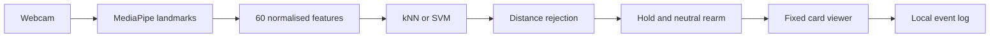

<div align="center">

# GestureForge

**Personal gestures. Deliberate control.**

A local desktop AI prototype that learns personal hand poses<br>
and advances a card viewer through intentional gesture holds.

[](https://github.com/Chi944/GestureForge_304/actions/workflows/checks.yml)


[Run the prototype](#getting-started) · [Pilot results](docs/evidence/PILOT_RESULTS.md) · [Design report](docs/ASSIGNMENT_REPORT.md) · [Agile board](https://github.com/users/Chi944/projects/1)


<sub>Actual Windows application, captured with the camera off. This image shows the interface; live gesture evidence is recorded separately in the pilot results.</sub>

</div>

---

## Assignment at a glance

| | |
| :--- | :--- |
| **Unit** | ICT304 |
| **Assignment deadline** | 3 October 2026 |
| **Final project deadline** | 7 November 2026 |
| **Assignment deliverable** | Personal gesture-recognition subsystem and NEXT-only card viewer |
| **AI techniques** | k-nearest neighbours and RBF support vector machine, compared with identical features and scaling |
| **Verified behaviour** | Real webcam-to-NEXT integration; participant-confirmed one action per hold with neutral rearming |
| **Pilot evidence** | One participant, 72 trials and 360 valid samples across separate training, validation and negative sessions |
| **Submission status** | Prototype verified; second-computer testing, tutor/team review and submission administration remain open |

The assignment and final project are two releases of this codebase. The final project adds substantial functionality and broader evaluation; its features are not claimed as implemented here.

## Contents

[Prototype](#what-the-prototype-does) · [Setup](#getting-started) · [Architecture](#how-it-works) · [Results](#results-and-limitations) · [Verification](#verification-and-reproducibility) · [Assessment](#assessment-evidence) · [Roadmap](#roadmap-and-next-steps) · [Credits](#project-structure-and-credits)

---

## What the prototype does

GestureForge supports a presenter or learner moving through a short deck without touching a mouse or keyboard. It recognises static poses from one enrolled hand and requires a deliberate activation sequence before moving a card.

| Pose label | Assignment behaviour | P01 pilot pose |
| :--- | :--- | :--- |
| **NEUTRAL** | Arms or rearms control after a 300 ms hold | Open palm |
| **NEXT** | Advances one card after a 400 ms hold | Closed fist |
| **PREVIOUS** | Recognition preview only | Thumb up |
| **BOOKMARK** | Recognition preview only | Index and middle fingers raised |

The viewer stays latched after an action until neutral rearming. Tracking loss and stale observations require neutral again. Pause stops camera control; mouse and keyboard controls remain available. Navigation does not wrap at deck boundaries.

These are personal example poses, not a universal gesture vocabulary or sign-language translation system.

## Getting started

### 1. Install and open the viewer

Requirements: **Windows**, **Python 3.11**, and internet access for initial dependency and model setup. A webcam is needed for collection and live recognition.

Open PowerShell in the repository folder:

```powershell
.\setup.cmd
.\run.cmd
```

Setup installs the pinned dependencies and verifies the pretrained hand-landmark asset. If Python is not registered with the Windows launcher, supply its path with `-PythonExe`, for example `.\setup.cmd -PythonExe "C:\Path\To\python.exe"`; see the [user guide](docs/USER_GUIDE.md).

A fresh clone opens the **manual card viewer**. Live recognition requires a personal dataset. Participant features are excluded from GitHub and the source archive; the [collection guide](docs/DATA_COLLECTION.md) explains how to record them.

For another Intel/AMD Windows laptop, extract the source ZIP, install **64-bit Python 3.11**, then double-click `setup.cmd` and `run.cmd`. Follow the [Windows laptop guide](docs/WINDOWS_LAPTOP.md) for camera selection, personal enrolment and physical-device acceptance checks. Git is not required to use the ZIP. Create a new environment on each computer; do not copy `.venv`.

### 2. Check the camera and launch the local pilot

After the P01 dataset has been collected on this computer:

```powershell
.\.venv\Scripts\python.exe scripts/check_environment.py --camera --camera-index 1
.\run.cmd --dataset data/local/pilot/manifest.json --algorithm knn --multiplier 2 --camera 1
```

Index `1` is the verified device on the development computer. Indices can change; select the working index on your machine and close other camera applications first. The shown rejection setting is provisional for P01, not automatically suitable for another participant.

### 3. Demonstrate deliberate control

1. Click **Start camera control** and hold an open palm until **READY**.
2. Make a fist until one card advances. Continue holding: the card should remain unchanged.
3. Return to open palm, then make a fist for the next advance.
4. Press **Esc** or **Pause / camera off** to pause. Use **Right arrow** or **Next card** for manual navigation.

The [complete user guide](docs/USER_GUIDE.md) includes collection, troubleshooting and installation details.

---

## How it works



MediaPipe supplies the pretrained hand tracker. The project's AI work is feature preprocessing, personal classifier training, rejection calibration, technique comparison and activation-controller integration.

- **Features:** wrist-relative world landmarks, scaled by wrist-to-middle-knuckle distance; 60 values per valid observation.
- **Training:** `StandardScaler` fitted only on TRAIN data, then kNN or RBF SVM. Neighbouring frames are never randomly split across training and validation.
- **Rejection:** class-specific distances calibrated from other training trials. Version 2 excludes the entire originating trial from reference neighbours.
- **Storage:** numeric arrays and JSON configurations. Models are rebuilt on load; no pickle/joblib model loading.
- **Responsiveness:** camera processing outside the GUI thread, with a single latest-result mailbox.

The [design report](docs/ASSIGNMENT_REPORT.md) documents interfaces, state transitions, requirements and technique rationale.

## Results and limitations

### Preliminary development validation

| Classifier | Trial macro-F1 | Correct validation trials | Rejection multiplier |
| :--- | ---: | ---: | ---: |
| kNN, 5 neighbours, distance weighting | **0.9686** | 31 / 32 | 2.0 |
| RBF SVM, C = 1, gamma = scale | **0.9686** | 31 / 32 | 2.0 |

Training and validation were separate recording sessions from **one consenting participant using the right hand**. Each enrolled label had eight trials per session and five scheduled samples per trial. Eight additional unfamiliar-pose trials supplied 40 negative samples.

These are development results: validation feedback informed the rejection correction. They do not establish untouched test performance, performance on unenrolled users, or the final project's live false-action target.

**Known limitation:** 25 of 40 unfamiliar-pose samples were accepted as BOOKMARK. None were accepted as NEXT, but that small sample does not prove zero unintended actions. BOOKMARK remains preview-only. The earlier over-rejecting baseline, correction, confusion matrix and per-class results are preserved in the [pilot evidence](docs/evidence/PILOT_RESULTS.md).

## Verification and reproducibility

Recorded local verification includes **55 passing tests**, Ruff, mypy, desktop startup/shutdown and synthetic evaluation. The extracted source copy also passed in a separate environment on the same computer. A second Windows computer remains an independent release gate.

```powershell
# Software checks; synthetic results are software evidence only
.\.venv\Scripts\python.exe scripts/verify.py

# Participant comparison, when the local dataset is available
.\.venv\Scripts\python.exe -m gestureforge.evaluate --config experiments/pilot.json --output experiments/local/reproduced-pilot.json
```

| Evidence | What it establishes |
| :--- | :--- |
| [Software checks](docs/evidence/verification.json) | Exact commands, versions and automated results |
| [Clean-install checks](docs/evidence/CLEAN_INSTALL.md), [setup script check](docs/evidence/SETUP_CHECK.md) | Extracted-source verification, fresh setup and their limits |
| [Windows laptop package check](docs/evidence/WINDOWS_LAPTOP_CHECK.md) | Fresh ZIP installation in a path with spaces, model inference and launcher verification |
| [Hardware and live checks](docs/evidence/HARDWARE_CHECK.md) | Camera operation, personal collection and live NEXT observations |
| [Pilot comparison](docs/evidence/PILOT_RESULTS.md) | Initial and corrected results, rejection trade-offs and reproduction command |
| [Review record](docs/evidence/REVIEW.md) | Confirmed findings and follow-up review |

## Assessment evidence

| Marker task | Start here |
| :--- | :--- |
| Problem, requirements, design and technique investigation | [Assignment design report](docs/ASSIGNMENT_REPORT.md) |
| Requirements mapped to implemented and planned tests | [Test plan and traceability](docs/TEST_PLAN.md) |
| Assessment coverage and remaining gates | [Assessment audit](docs/ASSESSMENT_AUDIT.md) |
| Data collection and consent boundaries | [Collection protocol](docs/DATA_COLLECTION.md) |
| Lifecycle, scope and schedule | [Build plan](docs/BUILD_PLAN.md) |
| Agile progress and decisions | [Agile method](docs/AGILE.md), [GitHub board](https://github.com/users/Chi944/projects/1), [decision/risk log](docs/DECISIONS_AND_RISKS.md) |
| Tool assistance, contributions and attribution | [AI-use record](AI_PROMPTS.md), [contributions](docs/CONTRIBUTIONS.md), [dependency/model sources](LICENSES.md) |
| Submission package preparation | [Assignment checklist](docs/SUBMISSION_CHECKLIST_ASSIGNMENT.md) |

## Roadmap and next steps

| Assignment prototype — 3 October | Final project extension — 7 November |
| :--- | :--- |
| CLI enrolment for one participant | Guided in-app enrolment and practice |
| Four recognised labels; NEXT executes | PREVIOUS and BOOKMARK also execute |
| One fixed ten-card deck | Validated JSON decks and saved bookmarks/position |
| Local dataset and configurations | Multiple local profiles with create/reload/delete |
| Preliminary comparison and live smoke checks | Refined rejection, two personal profiles, held-out and full-system evaluation |

**Next:** complete the second-computer release test, resolve tutor/team and data-sharing details, review/export the report, obtain the signed declaration, and verify the LMS upload. The [next-steps checklist](docs/ASSIGNMENT_NEXT_STEPS.md) distinguishes repository work from tasks needing people or another device.

Dynamic gestures, two-handed commands, OS/PowerPoint control, cloud accounts, mobile apps and an executable installer are outside the committed scope.

## Project structure and credits

```text
gestureforge/    App, camera, features, models, controller and evaluation
tests/          Automated checks for implemented assignment subsystems
assets/         Fixed deck and pretrained-model manifest
experiments/    Reproducible experiment configurations
scripts/        Setup, verification, agile board and source packaging
docs/           Report, guides, traceability, evidence and checklists
data/local/     Private participant features; ignored by Git
releases/       Locally generated source archives; ignored by Git
```

Team names, verified responsibilities and signatures must be completed from actual contributions in [CONTRIBUTIONS.md](docs/CONTRIBUTIONS.md). AI-assisted implementation and documentation are disclosed in [AI_PROMPTS.md](AI_PROMPTS.md). MediaPipe, OpenCV, PySide6, NumPy and scikit-learn provide the underlying libraries; their sources and licences are recorded in [LICENSES.md](LICENSES.md).

The generated source archive is **not the complete assignment submission**. Participant evidence may be included only with appropriate permission, and the reviewed report and signed declaration must be packaged separately.
