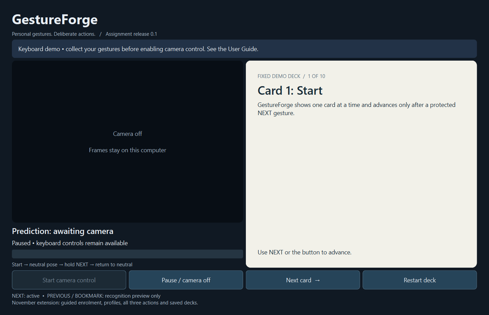
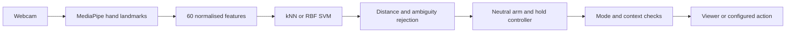

<div align="center">

# GestureForge

### Personal gesture controls for training, demonstrations and desktop workflows

**Local processing** · **Personal profiles** · **Deliberate activation** · Python 3.11

[Quick start](#quick-start) · [Using Studio](#using-studio) · [Recognition evidence](#recognition-evidence) · [User guide](docs/USER_GUIDE.md) · [Trello](https://trello.com/b/wDb978u6)

</div>

GestureForge Studio turns personally enrolled hand poses into deliberate actions:
navigate a card deck, bookmark a useful card, move through a demonstration runbook
or request a configured Windows shortcut. A neutral pose arms control; holding an
action pose triggers it once, then neutral is required again.

Webcam processing and classifier training run locally. Normal use does not save
photos or video. Numeric collection and evaluation recording require explicit
consent. **GestureForge controls its own viewer; it is not connected to PowerPoint.**

> **Current status:** Studio is under active development. Manual controls and
> personal enrolment are available. No approved shared starter model is bundled;
> personal Live gestures require the current session's full Practice pass.
> The frozen held-out comparison is complete, with unmet recognition targets;
> model improvement and remaining device checks are still in progress.



*The earlier card-viewer interface above shows the foundation of Studio. See the
[user guide](docs/USER_GUIDE.md) for the current Studio tabs and controls.*

## What you can do

| Capability | Current behaviour |
| :--- | :--- |
| Personal profiles | Create, load, rename and delete local profiles; return to Guest/manual mode without deleting samples |
| Guided enrolment | Record three action poses plus NEUTRAL with timed trials and invalid-sample feedback |
| Practice | Rehearse in simulation and inspect per-pose outcomes before enabling personal Live gestures |
| Decks and bookmarks | Load validated JSON decks; navigate, bookmark and explicitly save/restore progress |
| Workspaces and runbooks | Organise a demonstration into stages with visible gesture-to-action mappings |
| Quick Actions | Configure a local target library and three gesture slots; simulate requests or explicitly enable Windows launches |
| Session review | Inspect simulated/manual actions, launch requests, failures and stage acknowledgements |
| Reproducible evaluation | Compare kNN and RBF SVM; freeze inputs/settings before comparing starter and personal models on the same TEST observations |

Preview and Rehearsal simulate action requests. **Live is an explicit choice**;
loading a profile, restoring a session or changing a mapping never starts camera
control automatically. A launch request is recorded separately from successful
task completion.

## Quick start

### Windows

Use Windows 10/11 on an Intel/AMD computer with **64-bit Python 3.11**. Clone this
repository or extract the source ZIP, then open PowerShell in its folder:

```powershell
.\setup.cmd
.\run-studio.cmd
```

Setup installs the pinned dependencies and prepares the hand-landmark asset.
After setup, double-click **run-studio.cmd** to reopen Studio.
Start in Guest/manual mode to explore Studio without a webcam or dataset.
See the [Windows guide](docs/WINDOWS_LAPTOP.md) for setup and troubleshooting.

### Apple Silicon Mac

The setup target is **macOS 13+ with native arm64 Python 3.11**:

```bash
python3.11 scripts/setup_macos.py
bash run-studio.command
```

Use a fresh Mac environment rather than copying a Windows `.venv`. Allow camera
access for the launching application when requested. The Mac path supports the
viewer and personal recognition workflow; **external application shortcuts are
Windows-specific**. Intel Macs are outside this setup path.

Dependency resolution has been checked for Apple Silicon. Full native Mac
installation, webcam operation and smoothness still need device verification;
successful browser data collection on macOS does not establish native Studio
compatibility. See the [Mac guide](docs/MACOS.md).

The Studio source ZIP needs this setup; it is different from the browser-only
participant recording kits. Existing `run.cmd --studio` / `bash run.sh --studio`
commands still work. Keep personal data and saved profiles when extracting an update
into a separate folder.

### Minimal card viewer

Run `.\run.cmd` on Windows or `bash run.sh` on Mac without `--studio` to open the
smaller viewer. It uses a fixed deck and executes NEXT only; PREVIOUS and BOOKMARK
are recognition previews in that mode. Studio provides the wider workflow above.

## Using Studio

1. **Explore manually.** Open Setup. Select Live under **Studio action mode**,
   then choose **Apply and pause** for real manual deck actions. Stay in Preview
   to simulate requests. A personal model is not required for manual controls.
2. **Choose your workspace.** Load a validated deck or use the supplied
   [Harbor demonstration](docs/project/DEMO_SCENARIO.md). Quick Actions can also
   be used independently of a deck or runbook.
3. **Enrol or load your own profile.** Use Enrolment to collect numeric samples,
   or Profiles to create/load a profile from an existing TRAIN manifest. A deck
   or workspace JSON is not a gesture dataset. Loading remains paused.
4. **Check the camera.** In Setup, choose **Camera index** and **Use camera and
   pause**. Index 0 is often the built-in camera; try 1 for another connected
   device. Close other applications using that camera.
5. **Rehearse.** Open Practice, review the negative-pose cues and consent, then
   start the full 22-window protocol. Follow **Prepare next trial** and **Begin
   five-second window**. The camera intentionally releases between windows.
6. **Activate deliberately.** After a saved, reconciled full Practice pass in
   this app session, explicitly choose Live, apply, start capture and show
   NEUTRAL until READY. Hold the desired pose once, then return to NEUTRAL.
   **Esc** or **Pause / camera off** stops gesture control.

A diagnostic or short readiness check does not grant personal Live eligibility.
If PREVIOUS or another pose shows **Unrecognised**, read the rejection reason;
this is not a request to repeat the full Practice protocol. See the
[short recognition diagnostic](docs/USER_GUIDE.md#studio-shows-unrecognised-for-previous-or-another-pose).
Changing the model, camera, gesture meanings or target configuration expires the
grant. Restarting Studio also clears it. Focus loss pauses capture; resume
explicitly. See [Practice and Live instructions](docs/USER_GUIDE.md#personal-practice).

A bookmark marks the current card for later review; repeating the action keeps
one bookmark and does not advance the card. Use **Manual browse / bookmarks** to
revisit or remove it, and save deck progress to retain it across sessions.

If Studio remains LATCHED, inspect the prediction and rejection explanation:
rearming needs an **accepted, steady NEUTRAL** pose. An open palm can still be
rejected by a personal classifier. See the [rearming guide](docs/USER_GUIDE.md#studio-stays-latched-with-an-open-palm).

## How recognition works



MediaPipe provides pretrained hand tracking. GestureForge implements the
wrist-relative feature pipeline, personal classifiers, rejection, comparison and
application integration. Feature scaling is fitted on TRAIN only; frames from one
trial remain in one split. Profiles rebuild small models from numeric arrays and
JSON rather than loading executable pickle files.

Camera inference runs outside the UI thread with a latest-result mailbox.
Missing/multiple/wrong hands, invalid features and rejected predictions cannot
dispatch an action. The controller checks timing and generations and requires
neutral rearming between holds. An unfamiliar pose should display **Unrecognised**;
PREVIOUS and BOOKMARK are not fallback labels, although misclassification remains
possible.

## Recognition evidence

The figures below are **development validation**, not untouched TEST performance
or a claim that arbitrary new users can control Studio immediately.

| Personal comparison | Trial macro-F1 | Unfamiliar samples accepted as commands | Interpretation |
| :--- | ---: | ---: | :--- |
| P01 pilot, v3 kNN / SVM | 0.967 / 0.967 | 5/40 | One-person pilot; movement, orientation and framing remain limitations |
| P67 selected kNN | 0.790 | 12/40 | Frozen for a paired offline experiment; below the 0.90 personal target |
| P1543 selected SVM | 0.667 | 10/40 | Frozen for the same experiment; below target |

Negative sample predictions are not measured live false actions. The shared
starter investigation found no qualifying model. Freezing the two comparisons
makes their later evaluation reproducible; it does not approve deployment.

The [14 October paired TEST evaluation](docs/project/GF_P18_TEST_RESULTS_2026_10_14.md)
is complete for two held-out participants. Starter/personal trial macro-F1 is
**0.769/0.718 for P67** and **0.979/0.397 for P1543**. Both personal models
rejected every NEXT trial. These failed targets remain visible; the starter is
not approved for general use and personal LIVE still requires its readiness gate.

See [pilot evidence](docs/evidence/RESULTS.md), [H2 selection and limitations](docs/project/H2_EVALUATION_SELECTION_2026_10_14.md)
and the [paired evaluation protocol](docs/project/PAIRED_EVALUATION.md). Physical
camera, workflow, false-action and stability tests are tracked separately from
classifier accuracy and automated software checks.

The [development rejection diagnostic](docs/project/GF_P21_DEVELOPMENT_DIAGNOSIS_2026_10_15.md)
reproduces the selected models' failures using DEVELOPMENT data only, without
changing production recognition. It refuses TEST inputs and preserves invalid
observations. The next isolated representation experiment uses existing data;
it is not a new deployed model or an improvement already demonstrated.

## Participant collection

The [browser collection kits](docs/project/PARTICIPANT_KITS.md) require a webcam
and an existing browser, with no Python or coding tools. Each ZIP bundles the
recorder and PDF instructions. Participants export and return the generated
`EMAIL_THIS_...zip`; they do not send the application folder. Nothing is uploaded
automatically.

- **Development kits:** TRAIN, separate VALIDATION and UNKNOWN; approximately
  15–20 minutes plus a break, setup and saving.
- **Frozen TEST kits:** one assigned participant, 48 new trials; approximately
  6–8 minutes recording; allow about 10 minutes overall. Participant/session are preset: unzip, open
  the page, tick consent, **Open camera**, then **Start 48 trials**. No required
  typing. Old development recordings cannot be reused.

These are collection tools, not the Studio application. Each participant checks
their actual camera preview before starting; software checks do not establish
physical compatibility with every browser. Preserve partial attempts and invalid
slots; never delete difficult trials to improve scores. Follow the [current GF-P18 steps](docs/project/PAIRED_EVALUATION.md#current-gf-p18-next-steps).

## Verify and reproduce

From the configured Windows environment:

```powershell
.\.venv\Scripts\python.exe scripts/verify.py --timeout 1200
```

This runs lint, type checks, tests, both GUI startup checks and synthetic
evaluation. It prints the path to a new timestamped report under ignored
`experiments/local/`; historical reports are preserved. If supplying `--output`
or `--synthetic-output`, choose new filenames: existing files are refused.
To check the browser collector, developers with Node.js can also run:

```text
node --test tests/participant_collector.test.mjs
```

The verified 14 October build passed **952 Python tests and 30 browser-logic
checks**, plus lint, type checks, both startup checks and synthetic evaluation.
One unsupported Windows symlink fixture was skipped. These checks do not replace
real-device or participant evidence. Evaluation refuses existing output paths to
preserve recorded results.

Verification runs locally. The GitHub Actions workflow is manual-only while
hosted usage is unavailable. This desktop application needs no deployment service.

## Documentation and development

| Topic | Guide |
| :--- | :--- |
| Installation and operation | [User guide](docs/USER_GUIDE.md), [Windows](docs/WINDOWS_LAPTOP.md), [macOS](docs/MACOS.md) |
| Data and evaluation | [Collection protocol](docs/DATA_COLLECTION.md), [participant kits](docs/project/PARTICIPANT_KITS.md), [paired evaluation](docs/project/PAIRED_EVALUATION.md) |
| Design and verification | [Shared contracts](docs/project/CONTRACTS.md), [test plan](docs/TEST_PLAN.md), [workflow comparison](docs/project/WORKFLOW_COMPARISON.md) |
| Team coordination | [Team guide](docs/project/TEAM_GUIDE.md), [accepted progress](docs/project/PROGRESS.md), [agile record](docs/AGILE.md) |
| Packaging | [Release instructions](releases/README.md) |
| Attribution | [Dependencies and references](LICENSES.md), [pinned dependencies](requirements.lock), [model provenance](assets/model_manifest.json) |

Hau Jie owns profiles/recognition; Javier owns viewer/workspaces/shortcuts; Deston
owns integration, design and acceptance. Teammates push their own branches and
open reviewed pull requests; `main` holds integrated work.

```text
gestureforge/       Desktop application and recognition pipeline
participant/        Browser data collector
tests/              Regression checks
assets/             Decks, workspaces and model provenance
experiments/        Reproducible configurations
scripts/            Setup, verification and packaging
docs/               Guides, contracts and evidence
```

Private samples, full reports, Word deliverables, environments and generated ZIPs
stay outside version control. Codex assisted development and documentation; the
team reviews and verifies its output. MediaPipe, OpenCV, PySide6, NumPy and
scikit-learn are credited in the dependency record.

Dynamic gestures, sign-language translation, two-handed commands, arbitrary OS
scripting, background control and direct PowerPoint integration are outside the
current scope.
