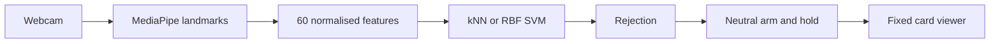

<div align="center">

# GestureForge

### Personal gesture recognition for deliberate card navigation

**ICT304 Assignment 1** · Python 3.11 · Local desktop prototype

[Technical report](docs/submission/GestureForge_Technical_Report.docx) · [Run the app](#run-the-prototype) · [Results](docs/evidence/RESULTS.md) · [Trello board](https://trello.com/b/wDb978u6/gestureforge-assignment-and-project)

</div>


GestureForge recognises four personally enrolled static hand poses using webcam landmarks and compares **kNN with RBF SVM**. A hold-and-rearm controller turns a deliberate NEXT pose into one card advance. Processing stays on the computer; normal use does not record camera images or video.

The assignment controls its own supplied ten-card deck. **It is not connected to PowerPoint.**

| Gesture | Assignment behaviour |
| :--- | :--- |
| NEUTRAL | Arms control after a stable hold and rearms between commands |
| NEXT | Advances one card per continuous hold |
| PREVIOUS / BOOKMARK | Recognition preview only; no viewer action |
| Unrecognised or invalid hand | No command; return to the enrolled neutral pose |

## Run the prototype

Use **64-bit Python 3.11 on an Intel/AMD Windows laptop**. Initial installation needs internet. macOS compatibility has not been verified for this pinned release.

Extract the source ZIP or clone this repository, then open PowerShell in its folder:

```powershell
.\setup.cmd
.\run.cmd
```

This opens the keyboard-only viewer. **A connected webcam does not enable Start camera control until a personal dataset is loaded.** Use the Next card button or Right arrow to try the deck without a camera.

For the enrolled P01 user on the development computer:

```powershell
.\.venv\Scripts\python.exe scripts/check_environment.py --camera --camera-index 1
.\run.cmd --dataset data/local/pilot/manifest.json --algorithm knn --multiplier 2 --margin 1.5 --camera 1
```

Camera indices can change. Close other camera applications and select the index that works on your computer. The source repository excludes P01's private samples; use the authorised private marker ZIP to reproduce P01, or follow the [collection instructions](docs/DATA_COLLECTION.md) to enrol your own hand in a separate folder. Never overwrite the retained P01 dataset.

1. Click **Start camera control** and show the enrolled NEUTRAL pose until READY.
2. Hold the enrolled NEXT pose until the card changes. Continuing to hold must not advance again.
3. Return to NEUTRAL before the next command.
4. Press **Esc** or **Pause / camera off** to stop gesture control. Manual controls remain available.

For P01, NEUTRAL was an open palm and NEXT was a fist. Another person's gestures must match their own collection. Keep the whole enrolled hand visible, still and similarly oriented to the training samples.

[Full user guide](docs/USER_GUIDE.md) · [Second Windows laptop setup](docs/WINDOWS_LAPTOP.md)

## How it works



MediaPipe supplies 21 hand landmarks. The project's work is the feature pipeline, personal classifier fitting and comparison, rejection calibration, controller and application integration. Wrist-relative world landmarks are scaled by wrist-to-middle-knuckle distance. The scaler is fitted only to TRAIN data. Entire trials remain within one recording split.

Camera inference runs outside the UI thread with one latest-result mailbox. No hand, multiple hands, the wrong hand, invalid features and rejected predictions cannot dispatch a command. A held gesture fires once, and neutral is required before another action. The model is rebuilt from numeric arrays and JSON rather than loaded from executable pickle files.

## Results and limits

The recommended live setting is **prototype-v3**, multiplier **2.0**, ambiguity margin **1.5**. The comparison below uses the same saved P01 development sessions:

| Setting | kNN / SVM trial macro-F1 | Correct trials | Unfamiliar samples accepted as command labels |
| :--- | ---: | ---: | ---: |
| Historical distance-only v2 | 0.9686 / 0.9686 | 31 / 32 | 25 / 40 |
| Recommended v3 with ambiguity rejection | 0.9667 / 0.9667 | 30 / 32 | 5 / 40 |

The improved model rejects 25/40 unfamiliar samples as UNKNOWN; 5 are still accepted as BOOKMARK and 10 as NEUTRAL. Two genuine trials become UNKNOWN (one NEXT, one NEUTRAL), and no validation trial is assigned to the wrong known class. This is an observed trade-off, not a perfect unknown detector. Fresh live validation of v3 remains pending.

One consenting participant supplied 160 training and 160 validation samples in separate sessions, plus 40 unfamiliar-pose samples. These are **development-validation results**, not untouched test results or performance on unenrolled people. Timing and per-class results are in the [consolidated evidence](docs/evidence/RESULTS.md).

Unfamiliar gestures should display **Unrecognised**. PREVIOUS and BOOKMARK are not fallback labels. However, a classifier can mistake an unfamiliar pose for a known pose: the historical model accepted 25/40 negative samples as BOOKMARK and 10/40 as NEUTRAL. Zero NEXT predictions in those samples does not prove zero live false actions. The v3 comparison above records the improvement separately from this historical baseline.

P01 confirmed two held NEXT gestures each advanced once after neutral rearming. P02 reported successful assisted ZIP use on another laptop, NEXT traversal from card 1 to 10, and one action during a five-second hold. P02's exact release/environment and guide-only installation, pause/restart and disconnected-network checks remain unverified. Orientation, movement, framing and distance remain limitations.

## Verify and reproduce

```powershell
# Automated tests, lint, type checks, GUI smoke and synthetic software checks
.\.venv\Scripts\python.exe scripts/verify.py

# Reproduce the recommended v3 comparison from the private P01 package
.\.venv\Scripts\python.exe -m gestureforge.evaluate --config experiments/pilot-rejection.json --output experiments/local/reproduced-pilot-v3.json

# Historical v2 comparison remains reproducible
.\.venv\Scripts\python.exe -m gestureforge.evaluate --config experiments/pilot.json --output experiments/local/reproduced-pilot.json
```

[Recorded software checks](docs/evidence/verification.json) distinguish automated verification from live hardware evidence. Synthetic fixtures test the software; they are not human recognition results.

## Submission map

| What the marker needs | Location |
| :--- | :--- |
| Problem, requirements, lifecycle, architecture, technique investigation and results | [Word technical report](docs/submission/GestureForge_Technical_Report.docx) |
| Requirement to test mapping and planned full-system evaluation | [Test plan](docs/TEST_PLAN.md) |
| Measured pilot and qualitative hardware/laptop evidence | [Results](docs/evidence/RESULTS.md) |
| Installation, operation and data protocol | [User guide](docs/USER_GUIDE.md), [Windows guide](docs/WINDOWS_LAPTOP.md), [collection protocol](docs/DATA_COLLECTION.md) |
| AI assistance declaration and preserved prompts | [prompt_log.md](prompt_log.md) |
| Decisions, alternatives, risks and scope boundaries | [decision_log.md](decision_log.md) |
| Agile tools and progress | [Agile record](docs/AGILE.md), [backlog snapshot](docs/backlog.csv) |
| Team contributions and required declaration | [Contribution record](docs/CONTRIBUTIONS.md), [official unsigned form](docs/submission/Group_Declaration_TO_COMPLETE.docx) |
| Dependencies, sources and reproducibility | [Licences and references](LICENSES.md), [requirements.lock](requirements.lock), [model manifest](assets/model_manifest.json) |

**Before submission:** complete full team identifiers, actual contributions and agreed percentages, tutor/AI-use review, retention arrangements, remaining laptop checks, report review and signatures. Keep the signed declaration and private data in the private LMS package. Verify the downloaded LMS upload. These human steps have not been completed by automated software checks.

## Assignment and project boundary

| Assignment due 3 October 2026 | Project extension due 7 November 2026 |
| :--- | :--- |
| Command-line personal collection | In-app enrolment and practice |
| Four labels with NEXT execution | PREVIOUS and BOOKMARK execution |
| Fixed supplied deck | Validated custom JSON decks |
| Local numeric dataset and configuration | Multiple profile creation, reload and deletion |
| Preliminary comparison and controller tests | Saved deck state and bookmarks; held-out two-profile and full-system evaluation |

Dynamic gestures, sign-language translation, two-handed commands, PowerPoint/OS control, cloud accounts, mobile apps and an installer are outside the committed scope.

## Repository layout

```text
gestureforge/       Application and AI subsystem
tests/              Automated regression checks
assets/             Supplied deck and model provenance
experiments/        Reproducible configurations
scripts/            Setup, verification and packaging
docs/               Final report, guides, traceability and evidence
prompt_log.md       Preserved user prompts and AI declaration
decision_log.md     Decisions and risks
```

Private data, environments, generated ZIPs and local working archives are ignored by Git. Redundant drafts, older PDFs and internal checklists are retained locally rather than included in the graded source. See [release instructions](releases/README.md) for the source and authorised private marker packages.

Jameson and Deston are the supplied team names; verified responsibilities and full identifiers remain pending. Codex assistance is disclosed in the prompt log. MediaPipe, OpenCV, PySide6, NumPy and scikit-learn are credited in the licence record.
