# GestureForge Assignment Design Report Draft

Status: formal draft, not ready to submit. The assignment prototype, pilot comparison and participant-observed live NEXT hold/rearm check are verified. Assignment completion still requires the second-computer check, tutor/team review, marker access and retention agreement, final report review and signed declaration. Formal repeated-hold, live false-action, latency and held-out evaluation remain final-project deliverables.

## Executive Summary

GestureForge is a local Windows desktop prototype that recognises a small personal set of static webcam hand gestures and uses a conservative activation controller to advance a card viewer. The assignment release implements the AI prototype and integration shell while keeping scope deliberately narrow: NEXT is the only gesture that executes a viewer command. PREVIOUS and BOOKMARK are recognised labels for preview and evaluation only.

The final project will extend this codebase with in-app enrolment, multiple profiles, PREVIOUS and BOOKMARK execution, JSON decks, saved state, held-out testing for two participants, and a final demo video. This assignment does not finish those final-project features.

Current software evidence is summarised in `docs/evidence/verification.json`: Ruff passed, mypy passed, pytest passed, GUI smoke launch passed, and synthetic evaluation completed. The MediaPipe asset downloaded and initialised, and a blank-image MediaPipe smoke check returned zero hands. Early QuickCam checks produced black or slow frames, but wrong device selection, backend behaviour, and possible Windows Camera app contention confounded that evidence. After replacing the webcam, Windows lists `Slim1322AF` and `USB2.0 HD UVC WebCam`. Camera index 1 with OpenCV's default backend now provides usable non-black video: a 60-frame run completed with post-warmup mean 31.24 ms, about 32 fps, max 63 ms, and clean shutdown. A later visible/topmost 60-second preview processed 1,145 frames, detected one hand in 338 frames, reported Left and Right handedness labels, and closed cleanly. These are detector-activity counts from an interactive preview, not gesture-recognition accuracy. The user consented to local numeric P01 data collection with the right hand, no raw frames, and GitHub exclusion. TRAIN and VALIDATION each completed 32 trials and 160 of 160 valid scheduled samples; validation-negative completed 8 trials and 40 valid samples. Corrected development validation reached macro-F1 0.9686 at multiplier 2.0 for both kNN and SVM, with 31 of 32 validation trials correct. A local live event log records genuine webcam gesture NEXT events advancing the viewer to positions 1, 2, and 3 through the personal kNN prototype-v2 multiplier 2.0 path. The participant then confirmed that two deliberate fist holds advanced exactly once each, with open-palm rearm between holds. This verifies the assignment NEXT path and provides a live hold smoke check, but the formal final-project twenty-hold run, live false-action rate, and latency targets remain pending; see docs/evidence/PILOT_RESULTS.md.

## Problem and User Need

The target user is a presenter, learner, or demonstrator who wants to move through a small deck without touching the keyboard or mouse. The problem is not general sign-language recognition. The problem is a bounded human-computer interaction task: recognise a small personal command set while avoiding accidental navigation.

The prototype uses personal examples rather than a universal gesture model. That keeps the assignment feasible because the classifier only needs to distinguish one enrolled user's static labels under documented camera, lighting, hand, and distance conditions.

## Assignment Scope

Implemented for the assignment prototype:

- Command-line collection for NEXT, PREVIOUS, BOOKMARK, NEUTRAL, and validation-negative sequences.
- Versioned manifest and numeric feature storage without pickle or joblib model files.
- Feature extraction from 21 MediaPipe landmarks into 60 normalised features.
- kNN and SVM training with train-only scaling.
- Class-conditional distance rejection.
- Reproducible evaluation from JSON config.
- A PySide6 desktop shell with fixed deck, camera preview area, prediction display, controller status, and keyboard/button fallback.
- A controller that can execute NEXT once per deliberate hold.
- Clear assignment boundary text showing PREVIOUS and BOOKMARK as preview-only.
- Local agile board, setup helper, source packaging helper, and documentation set.

Still pending for assignment evidence:

- Formal twenty-hold duplicate-action evidence.
- Live false-action and latency measurements.
- Second Windows computer install check.
- Marker access permission, retention agreement, signatures, and LMS evidence.
- Signed group declaration and LMS upload/download verification.

Excluded until the final project:

- In-app enrolment and practice.
- Profile create, reload, and delete.
- PREVIOUS and BOOKMARK execution.
- JSON deck loading.
- Saved deck position and bookmarks.
- Two-participant held-out final evaluation.

## Systems Engineering Approach

The project uses a tailored lifecycle. NASA's lifecycle model separates concept, preliminary design, detailed design, integration and test, operations, and closeout through gated reviews. GestureForge adapts that structure at assignment scale:

- Concept and feasibility: assignment scope, constraints, risk register, and assessment mapping.
- Preliminary design: requirements, data contracts, feature extraction, classifier plan, controller plan, and report draft.
- Detailed design and build: collection CLI, dataset persistence, training and evaluation, UI shell, controller, viewer, and helper scripts.
- Integration and verification: unit tests, static checks, GUI smoke test, model asset smoke test, live camera check, and release packaging.
- Operation and closeout: user guide, AI-use record, contribution record, signed declaration, release package, and final-project handover notes.

Agile tracking is maintained through `docs/backlog.csv`, local board generation with `python scripts/board.py`, and the private GitHub repository and project board recorded in `docs/GITHUB_SETUP.md`.

## Requirements and Current Status

| ID | Requirement | Assignment status | Evidence or blocker |
| --- | --- | --- | --- |
| RQ-001 | The system shall run locally on Windows with Python 3.11. | Software verified | Python 3.11.16 environment reported; second-machine check pending |
| RQ-002 | The system shall store project work under `code`. | Implemented | Repository and artifacts are under `code` |
| RQ-003 | The prototype shall collect labelled examples for NEXT, PREVIOUS, BOOKMARK, and NEUTRAL. | Implemented, pilot collected | `python -m gestureforge.collect`; P01 right-hand TRAIN and VALIDATION each have 32 trials and 160/160 valid scheduled samples; validation-negative has 40 valid samples |
| RQ-004 | The feature extractor shall produce 60 normalised landmark features from one selected hand. | Software verified | Automated tests reported passed |
| RQ-005 | The system shall reject no hand, multiple hands, wrong hand, non-finite landmarks, and degenerate scale. | Software verified | Automated tests and blank-image asset smoke reported |
| RQ-006 | The assignment shall compare kNN and SVM using the same preprocessing policy. | Development validation complete | `python -m gestureforge.evaluate`; corrected kNN and SVM share the same aggregate macro-F1 values across tested multipliers |
| RQ-007 | The controller shall require neutral arming and command hold before action dispatch. | Software verified | Controller tests reported passed |
| RQ-008 | The assignment viewer shall execute NEXT only. | Verified for basic live path | Genuine webcam gesture NEXT events advanced the viewer to positions 1, 2, and 3; participant-observed two-hold smoke check advanced once per hold |
| RQ-009 | The viewer shall avoid duplicate command execution from one continuous hold. | Software verified | Controller and viewer tests reported passed |
| RQ-010 | PREVIOUS and BOOKMARK shall be displayed as recognition preview only in the assignment. | Implemented | UI boundary text present |
| RQ-011 | Dataset manifests shall keep invalid detections rather than dropping them silently. | Software verified | Dataset tests reported passed |
| RQ-012 | Evaluation shall report macro-F1, per-class precision and recall, and confusion including UNKNOWN. | Development validation complete | Aggregate pilot metrics recorded in `docs/evidence/PILOT_RESULTS.md`; not held-out final test evidence |
| RQ-013 | The final project shall support profile persistence and reload. | Future | Not assignment scope |
| RQ-014 | The final project shall support validated JSON decks. | Future | Not assignment scope |
| RQ-015 | The final project shall include complete guide, video, and presentation evidence. | Future | Not assignment scope |

## Architecture

```mermaid
flowchart LR
    Webcam[Webcam frame] --> Capture[MediaPipe HandCamera]
    Capture --> Observation[Observation contract]
    Observation --> Features[Feature extraction]
    Features --> Model[kNN or SVM model]
    Model --> Rejection[Distance rejection]
    Rejection --> Prediction[Prediction contract]
    Prediction --> Controller[Activation controller]
    Controller --> Event[Command event]
    Event --> Viewer[Fixed card viewer]
    Viewer --> Log[Local event log]
```



The camera and inference worker run away from direct widget updates. The UI consumes only the latest available result, so a slow interface should not build an old-frame queue. Preview frames are mirrored for the user, but feature extraction uses the unmirrored landmark convention.

## Subsystem Inputs and Outputs

| Subsystem | Input | Output | Main safeguard |
| --- | --- | --- | --- |
| Capture | Webcam frame and MediaPipe model asset | Observation with hand count, landmarks, handedness, timestamp | No raw frame recording |
| Feature extraction | One valid selected-hand observation | 60-feature vector | Reject invalid scale, wrong hand, no hand, multiple hands, non-finite values |
| Dataset | Sample records and feature matrix | JSON manifest and NPZ sidecar | Hash check and split integrity validation |
| Model training | Training features and labels | In-memory prototype model config | Train-only `StandardScaler`; no executable model persistence |
| Evaluation | JSON config and dataset | Metrics, confusion matrix, predictions, timing | UNKNOWN accounting and trial-level majority |
| Controller | Accepted predictions and current time | Zero or one command event | Neutral arm, command hold, stale-frame rejection, latch |
| Viewer | Command event or keyboard input | Updated fixed deck position | No wrap and duplicate event rejection |
| Release tooling | Tracked Git files | Source ZIP and manifest | Excludes private local data and environments |

## Data Contracts

The code defines `Observation`, `Prediction`, and `CommandEvent` dataclasses in `gestureforge/contracts.py`. Dataset records are stored as reviewable JSON records with a compressed NumPy feature sidecar. Every prediction can be traced back to an observation, and every command event can be traced back to the prediction that caused it.

The assignment does not persist trained pickle or joblib models. It saves numeric training data and JSON configuration, then rebuilds the small classifiers when needed. This avoids accepting arbitrary executable model files.

## Feature Extraction Design

MediaPipe supplies 21 world landmarks for a detected hand. GestureForge normalises them as follows:

```text
origin = wrist
scale = distance(wrist, middle_finger_mcp)
normalised_landmark_i = (landmark_i - origin) / scale
feature_vector = flatten(normalised_landmarks_1_to_20)
```

The wrist landmark is removed after normalisation, leaving 20 landmarks times three coordinates, or 60 features. The preserved orientation helps distinguish different static poses, while translation and approximate hand-camera distance are reduced.

## Classifier and Rejection Design

Both classifiers use the same train-only scaling:

```text
z = (x - mean_train) / std_train
```

The assignment defaults for the implemented prototype path are:

- kNN: `KNeighborsClassifier(n_neighbors=5, weights="distance")`.
- SVM: `SVC(C=1, gamma="scale", kernel="rbf")`.
- Provisional assignment demonstration choice: kNN with rejection multiplier `2.0`.
- Model version: `prototype-v2`.

For a predicted class `c`, the model computes the distance from the scaled live feature vector `z` to the nearest scaled training example in class `c`:

```text
d(z, c) = min ||z - z_i|| for all training examples z_i with label c
```

For each class, the rejection threshold is the 95th percentile of leave-one-out nearest-neighbour distances inside that class, multiplied by the configured multiplier. The original `prototype-v1` implementation excluded only the exact sample being scored while estimating this reference distance. In the corrected `prototype-v2` implementation, the reference calculation excludes the whole originating training trial when trial IDs are available:

```text
reference_distance_i = nearest_same_class_distance(training_sample_i, excluding same trial)
threshold_c = quantile_0.95({reference_distance_i}) * multiplier
accept if d(z, c) <= threshold_c
```

This gives kNN and SVM the same rejection layer and makes false-action protection partly independent of the classifier's raw label. SVM decision values are not treated as confidence percentages. The prototype-v2 correction was guided by development validation results, so the reported pilot metrics are not untouched held-out test performance.

## Controller State Machine

| State | Meaning | Transition trigger |
| --- | --- | --- |
| PAUSED | Predictions are ignored | Start camera control calls `resume` |
| WAIT_NEUTRAL | System waits for a fresh neutral hold | 300 ms accepted NEUTRAL moves to READY |
| READY | System may consider executable commands | Accepted NEXT starts CANDIDATE |
| CANDIDATE | One executable command is being held | 400 ms stable NEXT emits one command event and moves to LATCHED |
| LATCHED | A command has already fired for the current hold | Accepted NEUTRAL begins rearm through WAIT_NEUTRAL |

Freshness rules reject future, stale, duplicate, out-of-order, and gapped predictions. The maximum accepted prediction age is 200 ms and the maximum frame gap is 200 ms. The assignment executable command set is `{"NEXT"}`.

## Related Work

MediaPipe Hands demonstrates real-time hand landmark tracking from RGB input and supports on-device interaction scenarios. GestureForge uses MediaPipe as an input subsystem, not as the team's own classifier contribution. Its limitation for this project is that good landmarks do not automatically solve deliberate command recognition or false-action control.

Wobbrock, Wilson, and Li's `$1` recognizer shows the value of lightweight, example-based gesture recognition for prototypes. GestureForge shares the assignment-friendly emphasis on fast prototyping and personal examples, but the interaction domain differs because GestureForge uses static hand poses from a webcam rather than 2D unistroke paths.

Cover and Hart's nearest-neighbour classification supports the use of instance-based classification for small datasets. The limitation is that nearest-neighbour performance depends strongly on representative training examples and distance choice.

Cortes and Vapnik's support-vector networks support the SVM comparison. The limitation is that an RBF SVM can be less intuitive to explain and requires careful parameter selection.

NASA's lifecycle material supports using gated reviews and maturity checks. The project adapts the idea rather than claiming a full aerospace lifecycle.

## Data Collection Plan

The assignment pilot uses one consenting participant. The user has consented to local numeric P01 collection using the right hand, with no raw frames and GitHub exclusion. The collection script records separate train, validation, and validation-negative sessions into `data/local/pilot/manifest.json` by default when run with the current machine's working camera index:

```powershell
python -m gestureforge.collect --camera 1 --split train --participant P01 --hand Right --setup "desk lighting, plain background" --consent --output data/local/pilot
python -m gestureforge.collect --camera 1 --split validation --participant P01 --hand Right --setup "desk lighting, plain background" --consent --output data/local/pilot
python -m gestureforge.collect --camera 1 --split validation_negative --participant P01 --hand Right --setup "desk lighting, plain background" --consent --output data/local/pilot
```

Each standard session uses four labels, eight trials per label by default, a two-second stable pose interval, and five scheduled samples per trial. Validation-negative uses UNKNOWN records to measure false command acceptance during non-command activity.

The completed TRAIN and VALIDATION sessions each contain 32 trials, eight per label, and 160 of 160 scheduled samples were valid. The validation-negative session contains 8 trials and 40 valid scheduled samples from unenrolled poses. Participant identity remains pseudonymous. Marker access permission, retention arrangements, and signed declarations are not yet granted. This report does not publish individual feature vectors, trial IDs, thresholds, raw images, raw video, or raw event logs.

## Evaluation Plan

Evaluation is run from JSON config:

```json
{
  "dataset_path": "data/local/pilot/manifest.json",
  "algorithms": ["knn", "svm"],
  "rejection_multiplier": 1.5
}
```

The evaluation reports:

- Trial-level majority prediction from the five scheduled samples.
- UNKNOWN when no majority exists.
- Macro-F1 across the four enrolled labels.
- Per-class precision, recall, and F1.
- Confusion matrix including UNKNOWN predictions.
- Rejection counts and validation-negative accepted command rate.
- Fit and prediction timing.

Synthetic fixtures may be used to test the software path, but the assignment report must label them separately and not present them as participant results.

Pilot aggregate results are recorded in `docs/evidence/PILOT_RESULTS.md`. The original sample-level leave-one-out baseline reached best macro-F1 0.5667 at multiplier 2.0. After the prototype-v2 whole-trial exclusion correction, kNN and SVM both reached macro-F1 0.8443 at multiplier 1.0, 0.9496 at multiplier 1.5, and 0.9686 at multiplier 2.0. At multiplier 2.0, 31 of 32 validation trials were correct, with one NEUTRAL trial predicted as PREVIOUS and no UNKNOWN validation trials.

The validation-negative results show a serious open-set weakness. For all corrected settings, 25 of 40 negative samples were accepted as BOOKMARK, while zero were accepted as NEXT or PREVIOUS. At multipliers 1.5 and 2.0, 10 of 40 negative samples were also accepted as NEUTRAL. Because BOOKMARK is recognition-preview-only in the assignment, this does not execute a command in the current prototype, but it means final full-command safety is not met or claimed.

## Current Verification Evidence

| Check | Current evidence |
| --- | --- |
| Automated tests | Passed; exact count recorded in `docs/evidence/verification.json` |
| Ruff | Passed; exact command output recorded in `docs/evidence/verification.json` |
| mypy | Passed; exact source-file count recorded in `docs/evidence/verification.json` |
| GUI smoke | Passed; command output recorded in `docs/evidence/verification.json`; screenshot render inspected by implementation lane |
| MediaPipe asset | Model downloaded, checksum verified, initialised |
| Blank image landmark smoke | Returned zero hands, which is expected for blank input |
| Camera enumeration | Windows lists `Slim1322AF` and `USB2.0 HD UVC WebCam` |
| User-supplied clear hand screenshot | MediaPipe IMAGE mode detected one hand; this is not live camera evidence |
| OpenCV camera index 0 | No usable capture in current checks |
| OpenCV camera index 1 | Default backend produced usable non-black video; 60 frames processed; post-warmup mean 31.24 ms, about 32 fps; max 63 ms; clean close |
| Earlier live camera hand detection | Zero hands detected in the 60-frame run and in an earlier 20-second, 304-frame preview; later found to be confounded because the user did not see the preview window |
| Visible/topmost live camera hand detection | 60-second camera-index 1 preview processed 1,145 frames, detected one hand in 338 frames, reported Left and Right handedness labels, and closed cleanly; this is detector activity, not recognition accuracy |
| P01 pilot collection | User consented to local numeric right-hand data with no raw frames and GitHub exclusion; TRAIN and VALIDATION each completed 32 trials with 160/160 valid scheduled samples; validation-negative completed 8 trials with 40 valid samples |
| Pilot classifier results | Corrected prototype-v2 kNN and SVM both reached macro-F1 0.9686 at multiplier 2.0 on development validation; not held-out final test evidence |
| Validation-negative result | Corrected settings accepted 25/40 negatives as BOOKMARK and 0/40 as NEXT or PREVIOUS; m1.5 and m2 also accepted 10/40 as NEUTRAL |
| Provisional assignment model | kNN prototype-v2 multiplier 2.0 selected for assignment NEXT-only demo because kNN and SVM tied on aggregate metrics and kNN is simpler to explain |
| Live NEXT path | Local live event log records genuine source=`gesture` NEXT events advancing viewer positions 1, 2, and 3 through webcam, landmarks, personal kNN, controller, and viewer |
| Hold smoke check | Participant confirmed two deliberate fist holds advanced exactly once each after open-palm rearm; this is not the formal final-project twenty-hold run |
| Live app shutdown | Both live application instances closed cleanly with exit code 0; the second opened the camera; no raw frames were saved |
| Capture backend policy | Uses OpenCV default backend, preserves negotiated camera format, retries at most five missing frames 30 ms apart, and does not force DirectShow |
| Final evidence file | `docs/evidence/verification.json` is the current software verification source of truth and may be refreshed by the root lane |

## Remaining Human Gates

- Formal twenty-hold duplicate-action run.
- Live false-action and latency measurements.
- Second Windows computer installation check.
- Tutor feedback on scope and marking-weight discrepancy.
- Marker access permission and retention arrangement.
- Signed group declaration.
- LMS upload and download verification.

## Tools Used

| Tool | Actual project use |
| --- | --- |
| Python 3.11.16 | Local runtime |
| PySide6 | Desktop GUI |
| OpenCV | Camera capture and preview frame handling |
| MediaPipe Hand Landmarker | Pretrained hand landmark detection |
| NumPy | Feature matrices and numeric operations |
| scikit-learn | `StandardScaler`, kNN, SVM, and metrics support |
| pytest | Automated regression tests |
| Ruff | Python linting |
| mypy | Static type checking |
| Git | Local version control |
| GitHub | Private repository, milestones, issues, and project board |
| AI assistance | Planning, code generation, tests, documentation, and review support under human responsibility |

## Risks

| Risk | Impact | Mitigation |
| --- | --- | --- |
| Camera index or backend opens the wrong device | Live demo or collection may silently use unusable video | Verify the device index with `python scripts/check_environment.py --camera --camera-index 1` before collection; recheck after unplugging or replugging cameras |
| Open-set rejection accepts BOOKMARK on negative poses | Final full-command project would risk unintended bookmark actions | Keep BOOKMARK preview-only for the assignment; improve rejection before final full-command release |
| Formal twenty-hold duplicate run is not complete | The final duplicate-action target needs more than the smoke check | Treat the two-hold result as smoke evidence only; run the formal series before claiming the final target |
| Pilot data is collected late | Report lacks real AI performance evidence | Prioritise a connected webcam and one-participant collection before polish |
| Overscoped assignment | Late or incomplete submission | Keep assignment to NEXT execution only |
| Synthetic results are confused with participant results | Misleading evaluation claims | Label synthetic software tests clearly |
| Missing declaration or upload verification | Marking penalty | Keep submission checklist and human gates visible |

## References

- Zhang, F. et al. (2020). MediaPipe Hands: On-device Real-time Hand Tracking. https://arxiv.org/abs/2006.10214
- Wobbrock, J. O., Wilson, A. D., and Li, Y. (2007). Gestures without libraries, toolkits or training: a $1 recognizer for user interface prototypes. https://depts.washington.edu/acelab/proj/dollar/index.html
- Cover, T. and Hart, P. (1967). Nearest Neighbor Pattern Classification. https://isl.stanford.edu/~cover/papers/transIT/0021cove.pdf
- Cortes, C. and Vapnik, V. (1995). Support-vector networks. https://doi.org/10.1007/BF00994018
- NASA. 3.0 NASA Program/Project Life Cycle. https://www.nasa.gov/reference/3-0-nasa-program-project-life-cycle/

## AI Assistance Declaration Draft

AI assistance was used to plan scope, implement prototype code, write automated tests, draft documentation, identify risks, and prepare report scaffolding. The team remains responsible for checking the code, running and preserving verification evidence, validating citations, collecting consented data, and ensuring every submitted claim is accurate. The full prompt archive is pending human review and should be included only after checking that it accurately represents the work performed.
