# GestureForge Assignment Design Report Draft

Status: formal draft, not ready to submit. Code and software verification are recorded in `docs/evidence/verification.json`, but the live camera demo, participant pilot data, second-machine check, tutor feedback, and signed declaration remain pending human or hardware gates.

## Executive Summary

GestureForge is a local Windows desktop prototype that recognises a small personal set of static webcam hand gestures and uses a conservative activation controller to advance a card viewer. The assignment release implements the AI prototype and integration shell while keeping scope deliberately narrow: NEXT is the only gesture that executes a viewer command. PREVIOUS and BOOKMARK are recognised labels for preview and evaluation only.

The final project will extend this codebase with in-app enrolment, multiple profiles, PREVIOUS and BOOKMARK execution, JSON decks, saved state, held-out testing for two participants, and a final demo video. This assignment does not finish those final-project features.

Current software evidence is summarised in `docs/evidence/verification.json`: Ruff passed, mypy passed, pytest passed, GUI smoke launch passed, and synthetic evaluation completed. The MediaPipe asset downloaded and initialised, and a blank-image MediaPipe smoke check returned zero hands. The user confirmed that no webcam is connected. Earlier camera checks returned no frames or stalled; these are not evidence of a defective physical camera. Live webcam NEXT control remains unverified until a webcam is connected and the pilot is demonstrated.

## Problem and User Need

The target user is a presenter, learner, or demonstrator who wants to move through a small deck without touching the keyboard or mouse. The problem is not general sign-language recognition. The problem is a bounded human-computer interaction task: recognise a small personal command set while avoiding accidental navigation.

The prototype uses personal examples rather than a universal gesture model. That keeps the assignment feasible because the classifier only needs to distinguish one enrolled user's static labels under documented camera, lighting, hand, and distance conditions.

## Assignment Scope

Implemented for the assignment prototype:

- Command-line collection for NEXT, PREVIOUS, BOOKMARK, NEUTRAL, and validation-negative sequences.
- Versioned manifest and numeric feature storage without pickle or joblib model files.
- Feature extraction from 21 MediaPipe landmarks into 60 normalised features.
- kNN and SVM training with train-only scaling.
- Class-conditional distance rejection.
- Reproducible evaluation from JSON config.
- A PySide6 desktop shell with fixed deck, camera preview area, prediction display, controller status, and keyboard/button fallback.
- A controller that can execute NEXT once per deliberate hold.
- Clear assignment boundary text showing PREVIOUS and BOOKMARK as preview-only.
- Local agile board, setup helper, source packaging helper, and documentation set.

Still pending for assignment evidence:

- Real participant consent.
- Human pilot train, validation, and validation-negative collection.
- Human classifier metrics.
- Working live webcam NEXT action.
- Second Windows computer install check.
- Signed group declaration and LMS upload/download verification.

Excluded until the final project:

- In-app enrolment and practice.
- Profile create, reload, and delete.
- PREVIOUS and BOOKMARK execution.
- JSON deck loading.
- Saved deck position and bookmarks.
- Two-participant held-out final evaluation.

## Systems Engineering Approach

The project uses a tailored lifecycle. NASA's lifecycle model separates concept, preliminary design, detailed design, integration and test, operations, and closeout through gated reviews. GestureForge adapts that structure at assignment scale:

- Concept and feasibility: assignment scope, constraints, risk register, and assessment mapping.
- Preliminary design: requirements, data contracts, feature extraction, classifier plan, controller plan, and report draft.
- Detailed design and build: collection CLI, dataset persistence, training and evaluation, UI shell, controller, viewer, and helper scripts.
- Integration and verification: unit tests, static checks, GUI smoke test, model asset smoke test, live camera check, and release packaging.
- Operation and closeout: user guide, AI-use record, contribution record, signed declaration, release package, and final-project handover notes.

Agile tracking is maintained through `docs/backlog.csv`, local board generation with `python scripts/board.py`, and the private GitHub repository and project board recorded in `docs/GITHUB_SETUP.md`.

## Requirements and Current Status

| ID | Requirement | Assignment status | Evidence or blocker |
| --- | --- | --- | --- |
| RQ-001 | The system shall run locally on Windows with Python 3.11. | Software verified | Python 3.11.16 environment reported; second-machine check pending |
| RQ-002 | The system shall store project work under `code`. | Implemented | Repository and artifacts are under `code` |
| RQ-003 | The prototype shall collect labelled examples for NEXT, PREVIOUS, BOOKMARK, and NEUTRAL. | Implemented, human data pending | `python -m gestureforge.collect`; consented pilot data still pending |
| RQ-004 | The feature extractor shall produce 60 normalised landmark features from one selected hand. | Software verified | Automated tests reported passed |
| RQ-005 | The system shall reject no hand, multiple hands, wrong hand, non-finite landmarks, and degenerate scale. | Software verified | Automated tests and blank-image asset smoke reported |
| RQ-006 | The assignment shall compare kNN and SVM using the same preprocessing policy. | Software verified | `python -m gestureforge.evaluate`; human pilot comparison pending |
| RQ-007 | The controller shall require neutral arming and command hold before action dispatch. | Software verified | Controller tests reported passed |
| RQ-008 | The assignment viewer shall execute NEXT only. | Software verified, live gate blocked | UI/controller code implements NEXT-only; live webcam blocked |
| RQ-009 | The viewer shall avoid duplicate command execution from one continuous hold. | Software verified | Controller and viewer tests reported passed |
| RQ-010 | PREVIOUS and BOOKMARK shall be displayed as recognition preview only in the assignment. | Implemented | UI boundary text present |
| RQ-011 | Dataset manifests shall keep invalid detections rather than dropping them silently. | Software verified | Dataset tests reported passed |
| RQ-012 | Evaluation shall report macro-F1, per-class precision and recall, and confusion including UNKNOWN. | Software verified | Evaluation tests reported passed; real metrics pending |
| RQ-013 | The final project shall support profile persistence and reload. | Future | Not assignment scope |
| RQ-014 | The final project shall support validated JSON decks. | Future | Not assignment scope |
| RQ-015 | The final project shall include complete guide, video, and presentation evidence. | Future | Not assignment scope |

## Architecture

```mermaid
flowchart LR
    Webcam[Webcam frame] --> Capture[MediaPipe HandCamera]
    Capture --> Observation[Observation contract]
    Observation --> Features[Feature extraction]
    Features --> Model[kNN or SVM model]
    Model --> Rejection[Distance rejection]
    Rejection --> Prediction[Prediction contract]
    Prediction --> Controller[Activation controller]
    Controller --> Event[Command event]
    Event --> Viewer[Fixed card viewer]
    Viewer --> Log[Local event log]
```



The camera and inference worker run away from direct widget updates. The UI consumes only the latest available result, so a slow interface should not build an old-frame queue. Preview frames are mirrored for the user, but feature extraction uses the unmirrored landmark convention.

## Subsystem Inputs and Outputs

| Subsystem | Input | Output | Main safeguard |
| --- | --- | --- | --- |
| Capture | Webcam frame and MediaPipe model asset | Observation with hand count, landmarks, handedness, timestamp | No raw frame recording |
| Feature extraction | One valid selected-hand observation | 60-feature vector | Reject invalid scale, wrong hand, no hand, multiple hands, non-finite values |
| Dataset | Sample records and feature matrix | JSON manifest and NPZ sidecar | Hash check and split integrity validation |
| Model training | Training features and labels | In-memory prototype model config | Train-only `StandardScaler`; no executable model persistence |
| Evaluation | JSON config and dataset | Metrics, confusion matrix, predictions, timing | UNKNOWN accounting and trial-level majority |
| Controller | Accepted predictions and current time | Zero or one command event | Neutral arm, command hold, stale-frame rejection, latch |
| Viewer | Command event or keyboard input | Updated fixed deck position | No wrap and duplicate event rejection |
| Release tooling | Tracked Git files | Source ZIP and manifest | Excludes private local data and environments |

## Data Contracts

The code defines `Observation`, `Prediction`, and `CommandEvent` dataclasses in `gestureforge/contracts.py`. Dataset records are stored as reviewable JSON records with a compressed NumPy feature sidecar. Every prediction can be traced back to an observation, and every command event can be traced back to the prediction that caused it.

The assignment does not persist trained pickle or joblib models. It saves numeric training data and JSON configuration, then rebuilds the small classifiers when needed. This avoids accepting arbitrary executable model files.

## Feature Extraction Design

MediaPipe supplies 21 world landmarks for a detected hand. GestureForge normalises them as follows:

```text
origin = wrist
scale = distance(wrist, middle_finger_mcp)
normalised_landmark_i = (landmark_i - origin) / scale
feature_vector = flatten(normalised_landmarks_1_to_20)
```

The wrist landmark is removed after normalisation, leaving 20 landmarks times three coordinates, or 60 features. The preserved orientation helps distinguish different static poses, while translation and approximate hand-camera distance are reduced.

## Classifier and Rejection Design

Both classifiers use the same train-only scaling:

```text
z = (x - mean_train) / std_train
```

The assignment defaults are:

- kNN: `KNeighborsClassifier(n_neighbors=5, weights="distance")`.
- SVM: `SVC(C=1, gamma="scale", kernel="rbf")`.
- Rejection multiplier: `1.5`.
- Model version: `prototype-v1`.

For a predicted class `c`, the model computes the distance from the scaled live feature vector `z` to the nearest scaled training example in class `c`:

```text
d(z, c) = min ||z - z_i|| for all training examples z_i with label c
```

For each class, the rejection threshold is the 95th percentile of leave-one-out nearest-neighbour distances inside that class, multiplied by the configured multiplier:

```text
threshold_c = quantile_0.95({nearest_same_class_distance_i}) * multiplier
accept if d(z, c) <= threshold_c
```

This gives kNN and SVM the same rejection layer and makes false-action protection partly independent of the classifier's raw label. SVM decision values are not treated as confidence percentages.

## Controller State Machine

| State | Meaning | Transition trigger |
| --- | --- | --- |
| PAUSED | Predictions are ignored | Start camera control calls `resume` |
| WAIT_NEUTRAL | System waits for a fresh neutral hold | 300 ms accepted NEUTRAL moves to READY |
| READY | System may consider executable commands | Accepted NEXT starts CANDIDATE |
| CANDIDATE | One executable command is being held | 400 ms stable NEXT emits one command event and moves to LATCHED |
| LATCHED | A command has already fired for the current hold | Accepted NEUTRAL begins rearm through WAIT_NEUTRAL |

Freshness rules reject future, stale, duplicate, out-of-order, and gapped predictions. The maximum accepted prediction age is 200 ms and the maximum frame gap is 200 ms. The assignment executable command set is `{"NEXT"}`.

## Related Work

MediaPipe Hands demonstrates real-time hand landmark tracking from RGB input and supports on-device interaction scenarios. GestureForge uses MediaPipe as an input subsystem, not as the team's own classifier contribution. Its limitation for this project is that good landmarks do not automatically solve deliberate command recognition or false-action control.

Wobbrock, Wilson, and Li's `$1` recognizer shows the value of lightweight, example-based gesture recognition for prototypes. GestureForge shares the assignment-friendly emphasis on fast prototyping and personal examples, but the interaction domain differs because GestureForge uses static hand poses from a webcam rather than 2D unistroke paths.

Cover and Hart's nearest-neighbour classification supports the use of instance-based classification for small datasets. The limitation is that nearest-neighbour performance depends strongly on representative training examples and distance choice.

Cortes and Vapnik's support-vector networks support the SVM comparison. The limitation is that an RBF SVM can be less intuitive to explain and requires careful parameter selection.

NASA's lifecycle material supports using gated reviews and maturity checks. The project adapts the idea rather than claiming a full aerospace lifecycle.

## Data Collection Plan

The assignment pilot requires one consenting participant. The collection script records separate train, validation, and validation-negative sessions into `data/local/pilot/manifest.json` by default when run with:

```powershell
python -m gestureforge.collect --split train --participant P01 --hand Right --setup "desk lighting, plain background" --consent --output data/local/pilot
python -m gestureforge.collect --split validation --participant P01 --hand Right --setup "desk lighting, plain background" --consent --output data/local/pilot
python -m gestureforge.collect --split validation_negative --participant P01 --hand Right --setup "desk lighting, plain background" --consent --output data/local/pilot
```

Each standard session uses four labels, eight trials per label by default, a two-second stable pose interval, and five scheduled samples per trial. Validation-negative uses UNKNOWN records to measure false command acceptance during non-command activity.

Participant identity should be pseudonymous. Consent and permitted retention must be confirmed before recording usable data.

## Evaluation Plan

Evaluation is run from JSON config:

```json
{
  "dataset_path": "data/local/pilot/manifest.json",
  "algorithms": ["knn", "svm"],
  "rejection_multiplier": 1.5
}
```

The evaluation reports:

- Trial-level majority prediction from the five scheduled samples.
- UNKNOWN when no majority exists.
- Macro-F1 across the four enrolled labels.
- Per-class precision, recall, and F1.
- Confusion matrix including UNKNOWN predictions.
- Rejection counts and validation-negative accepted command rate.
- Fit and prediction timing.

Synthetic fixtures may be used to test the software path, but the assignment report must label them separately and not present them as participant results.

## Current Verification Evidence

| Check | Current evidence |
| --- | --- |
| Automated tests | Passed; exact count recorded in `docs/evidence/verification.json` |
| Ruff | Passed; exact command output recorded in `docs/evidence/verification.json` |
| mypy | Passed; exact source-file count recorded in `docs/evidence/verification.json` |
| GUI smoke | Passed; command output recorded in `docs/evidence/verification.json`; screenshot render inspected by implementation lane |
| MediaPipe asset | Model downloaded, checksum verified, initialised |
| Blank image landmark smoke | Returned zero hands, which is expected for blank input |
| Default camera | Opened but returned no frames |
| DirectShow camera backend | Stalled |
| Final evidence file | `docs/evidence/verification.json` is the current software verification source of truth and may be refreshed by the root lane |

## Remaining Human Gates

- Participant consent.
- Pilot train, validation, and validation-negative collection.
- Human classifier comparison results.
- Live webcam NEXT action.
- Second Windows computer installation check.
- Tutor feedback on scope and marking-weight discrepancy.
- Signed group declaration.
- LMS upload and download verification.

## Tools Used

| Tool | Actual project use |
| --- | --- |
| Python 3.11.16 | Local runtime |
| PySide6 | Desktop GUI |
| OpenCV | Camera capture and preview frame handling |
| MediaPipe Hand Landmarker | Pretrained hand landmark detection |
| NumPy | Feature matrices and numeric operations |
| scikit-learn | `StandardScaler`, kNN, SVM, and metrics support |
| pytest | Automated regression tests |
| Ruff | Python linting |
| mypy | Static type checking |
| Git | Local version control |
| GitHub | Private repository, milestones, issues, and project board |
| AI assistance | Planning, code generation, tests, documentation, and review support under human responsibility |

## Risks

| Risk | Impact | Mitigation |
| --- | --- | --- |
| No webcam connected yet | Live demo cannot be completed | Connect a webcam, run the camera check and collect consented pilot data |
| Pilot data is collected late | Report lacks real AI performance evidence | Prioritise a connected webcam and one-participant collection before polish |
| Overscoped assignment | Late or incomplete submission | Keep assignment to NEXT execution only |
| Synthetic results are confused with participant results | Misleading evaluation claims | Label synthetic software tests clearly |
| Missing declaration or upload verification | Marking penalty | Keep submission checklist and human gates visible |

## References

- Zhang, F. et al. (2020). MediaPipe Hands: On-device Real-time Hand Tracking. https://arxiv.org/abs/2006.10214
- Wobbrock, J. O., Wilson, A. D., and Li, Y. (2007). Gestures without libraries, toolkits or training: a $1 recognizer for user interface prototypes. https://depts.washington.edu/acelab/proj/dollar/index.html
- Cover, T. and Hart, P. (1967). Nearest Neighbor Pattern Classification. https://isl.stanford.edu/~cover/papers/transIT/0021cove.pdf
- Cortes, C. and Vapnik, V. (1995). Support-vector networks. https://doi.org/10.1007/BF00994018
- NASA. 3.0 NASA Program/Project Life Cycle. https://www.nasa.gov/reference/3-0-nasa-program-project-life-cycle/

## AI Assistance Declaration Draft

AI assistance was used to plan scope, implement prototype code, write automated tests, draft documentation, identify risks, and prepare report scaffolding. The team remains responsible for checking the code, running and preserving verification evidence, validating citations, collecting consented data, and ensuring every submitted claim is accurate. The full prompt archive is pending human review and should be included only after checking that it accurately represents the work performed.
