# GestureForge Assignment Design Report Draft

Status: formal draft, not ready to submit. Documentation audited against the repository and recorded evidence on 27 September 2026; the recorded hardware and pilot runs are dated 23 September. The prototype has software checks, a development-validation comparison and a participant-observed two-hold NEXT smoke check. Fresh-source setup was tested on the development computer only. Assignment completion depends on the open [assignment checklist](SUBMISSION_CHECKLIST_ASSIGNMENT.md) gates: final report review, second-computer acceptance, tutor/team review, private P01 package retention notes, AI-use guidance check, signed declaration, and LMS upload/download verification. Formal repeated-hold, live false-action, latency and held-out evaluation remain [final-project deliverables](SUBMISSION_CHECKLIST_FINAL.md).

## Executive Summary

GestureForge is a local Windows desktop AI prototype for controlling a small card deck with personal static hand gestures. The assignment release proves the core AI subsystem and one real product workflow: webcam input is converted to MediaPipe hand landmarks, normalised into 60 numeric features, classified by both kNN and RBF SVM for comparison, filtered through distance-based rejection, and passed to a hold-and-rearm controller that executes NEXT once per deliberate hold.

The assignment scope is deliberately narrow so it can be demonstrated and defended. NEXT is the only gesture that performs a viewer action. PREVIOUS and BOOKMARK are recognised and displayed as preview-only labels, leaving meaningful implementation work for the 7 November final project: in-app enrolment, multiple profiles, PREVIOUS and BOOKMARK execution, user-selected validated JSON decks, saved state, held-out testing for two participants, and a final demo video.

The prototype is strong enough for a near-final assignment build but not ready to submit until the remaining human and packaging gates are closed. Software verification currently passes Ruff, mypy, pytest, GUI smoke launch and synthetic evaluation. The P01 right-hand pilot collected separate TRAIN and VALIDATION sessions with 32 trials and 160 valid scheduled samples each, plus 40 valid validation-negative samples. Corrected development validation reached macro-F1 0.9686 for both kNN and SVM at rejection multiplier 2.0, with 31 of 32 validation trials correct. Live P01 testing advanced cards through the full webcam-to-viewer NEXT path and confirmed two sustained NEXT holds each fired exactly once after NEUTRAL rearming.

[P02 laptop feedback recorded on 26 September](evidence/P02_LAPTOP_TEST.md) reports successful ZIP use with Codex assistance and a separately collected right-hand dataset: NEXT advanced Card 1 to Card 10, a five-second NEXT hold produced one action, NEUTRAL rearm was required, and PREVIOUS/BOOKMARK remained preview-only. The participant reported reduced reliability with motion, tilt, back-of-hand orientation, lateral position and excessive distance. These are qualitative observations, not isolated root causes or a formal guide-only installation, disconnected-network, pause/reopen or quantitative P02 accuracy result.

## Problem and User Need

The target user is a presenter, learner, or demonstrator who wants to move through a small deck without touching the keyboard or mouse. The problem is not general sign-language recognition. The problem is a bounded human-computer interaction task: recognise a small personal command set while avoiding accidental navigation.

The prototype uses personal examples rather than a universal gesture model. That keeps the assignment feasible because the classifier only needs to distinguish one enrolled user's static labels under documented camera, lighting, hand, and distance conditions.

## Innovation and AI Contribution

Common low-risk alternatives for this workflow are keyboard shortcuts, clickers, touch screens, voice commands, or fixed rule-based hand-pose thresholds. GestureForge's innovation is the combination of personal gesture enrolment, a small explainable classifier comparison, open-set rejection, and deliberate activation control. The aim is not to replace high-accuracy sign-language systems; it is to make a small touch-free viewer that can be trained quickly for one user and made safer against accidental repeated actions.

MediaPipe supplies the pretrained hand landmarks. The project's AI contribution is the system built around those landmarks: the dataset and manifest design, 60-feature normalisation, train-only scaling, kNN and SVM comparison, class-distance rejection, validation-negative analysis, and controller integration with hold/rearm safeguards. A real webcam NEXT gesture advances a card in the application; this integration result does not establish general live safety. AI assistance and verified human contributions must be disclosed separately.

## Assignment Scope

Implemented for the assignment prototype:

- Command-line collection for NEXT, PREVIOUS, BOOKMARK, NEUTRAL, and validation-negative sequences.
- Versioned manifest and numeric feature storage without pickle or joblib model files.
- Feature extraction from 21 MediaPipe landmarks into 60 normalised features.
- kNN and SVM training with train-only scaling.
- Class-conditional distance rejection.
- Reproducible evaluation from JSON config.
- A PySide6 desktop shell with fixed deck, camera preview area, prediction display, controller status, and keyboard/button fallback.
- A controller that can execute NEXT once per deliberate hold.
- Clear assignment boundary text showing PREVIOUS and BOOKMARK as preview-only.
- Local agile board, setup helper, source packaging helper, and documentation set.

Still pending before assignment submission:

- Human review of the exported report draft; regenerate after any content changes.
- Second Windows computer acceptance check from the [laptop guide](WINDOWS_LAPTOP.md#6-physical-laptop-acceptance-record); same-computer archive checks do not close it.
- Tutor/team review, team names, and contribution confirmation.
- Private P01 package retention note and AI-use guidance check.
- Signed group declaration and LMS upload/download verification.

Excluded until the final project:

- In-app enrolment and practice.
- Profile create, reload, and delete.
- PREVIOUS and BOOKMARK execution.
- User-selected, validated JSON deck loading; the assignment already loads its fixed ten-card deck from JSON.
- Saved deck position and bookmarks.
- Two-participant held-out final evaluation.

Not in agreed scope: PowerPoint control, operating-system control, dynamic gestures, two-handed gestures, sign-language translation, cloud accounts, mobile apps, deep-network training, or an installer executable.

## Systems Engineering Approach

The project uses a tailored lifecycle. NASA's lifecycle model separates concept, preliminary design, detailed design, integration and test, operations, and closeout through gated reviews. GestureForge adapts that structure at assignment scale:

- Concept and feasibility: assignment scope, constraints, risk register, and assessment mapping.
- Preliminary design: requirements, data contracts, feature extraction, classifier plan, controller plan, and report draft.
- Detailed design and build: collection CLI, dataset persistence, training and evaluation, UI shell, controller, viewer, and helper scripts.
- Integration and verification: unit tests, static checks, GUI smoke test, model asset smoke test, live camera check, and release packaging.
- Operation and closeout: user guide, AI-use record, contribution record, signed declaration, release package, and final-project handover notes.

Agile tracking is maintained through `docs/backlog.csv`, local board generation with `python scripts/board.py`, and the private GitHub repository and project board recorded in `docs/GITHUB_SETUP.md`.

## Milestones

The schedule keeps the assignment prototype and final project clearly separated.

| Date range | Assignment milestone | Exit gate |
| --- | --- | --- |
| 23-24 Sep | Repository layout, dependency check, camera/landmark feasibility and requirements draft | Development machine can run the stack and capture usable webcam input |
| 25-26 Sep | Collection CLI, feature pipeline, manifest, P01 pilot data and default training | Saved numeric data and first classifier outputs exist |
| 27-28 Sep | Fixed viewer, controller and live prediction integration | Real webcam NEXT advances one card once |
| 29-30 Sep | Classifier comparison, rejection tuning, tests and measured outputs | Preliminary results are reproducible and limitations are recorded |
| 1 Oct | Prototype freeze, install instructions and report reconciliation | Report claims match code and evidence |
| 2 Oct | Package review, declaration and LMS upload check | Downloaded submission package is rechecked |
| 3 Oct | Deadline buffer | Fixes and packaging corrections only |

| Date range | Final project milestone | Exit gate |
| --- | --- | --- |
| 4-11 Oct | In-app enrolment, practice, profile lifecycle and validation | Profiles can be created and reloaded |
| 12-18 Oct | PREVIOUS, BOOKMARK, JSON decks, saved state and recovery | Feature freeze |
| 19-25 Oct | Bounded validation search, frozen candidates, held-out data and live tasks | Final evaluation data collected |
| 26 Oct-1 Nov | Defect fixes, second-machine release test and stability run | Release candidate |
| 2-6 Nov | Final report, guide, video, slides and rehearsal | Submission ready |
| 7 Nov | Deadline buffer | No new features |

## Requirements and Current Status

| ID | Requirement | Assignment status | Evidence or blocker |
| --- | --- | --- | --- |
| RQ-001 | The system shall run locally on Windows with Python 3.11. | Software verified; assisted laptop use reported | Python 3.11.16 development environment recorded; P02 package/version details and full release acceptance remain pending |
| RQ-002 | The system shall store project work under `code`. | Implemented | Repository and artifacts are under `code` |
| RQ-003 | The prototype shall collect labelled examples for NEXT, PREVIOUS, BOOKMARK, and NEUTRAL. | Implemented, pilot collected | `python -m gestureforge.collect`; P01 right-hand TRAIN and VALIDATION each have 32 trials and 160/160 valid scheduled samples; validation-negative has 40 valid samples |
| RQ-004 | The feature extractor shall produce 60 normalised landmark features from one selected hand. | Software verified | Automated tests reported passed |
| RQ-005 | The system shall reject no hand, multiple hands, wrong hand, non-finite landmarks, and degenerate scale. | Software verified | Automated tests and blank-image asset smoke reported |
| RQ-006 | The assignment shall compare kNN and SVM using the same preprocessing policy. | Development validation complete | `python -m gestureforge.evaluate`; corrected kNN and SVM share the same aggregate macro-F1 values across tested multipliers |
| RQ-007 | The controller shall require neutral arming and command hold before action dispatch. | Software verified | Controller tests reported passed |
| RQ-008 | The assignment viewer shall execute NEXT only. | Verified for basic live path | Genuine webcam gesture NEXT events advanced the viewer to positions 1, 2, and 3; participant-observed two-hold smoke check advanced once per hold |
| RQ-009 | The viewer shall avoid duplicate command execution from one continuous hold. | Software verified | Controller and viewer tests reported passed |
| RQ-010 | PREVIOUS and BOOKMARK shall be displayed as recognition preview only in the assignment. | Implemented | UI boundary text present |
| RQ-011 | Dataset manifests shall keep invalid detections rather than dropping them silently. | Software verified | Dataset tests reported passed |
| RQ-012 | Evaluation shall report macro-F1, per-class precision and recall, and confusion including UNKNOWN. | Development validation complete | Aggregate pilot metrics recorded in `docs/evidence/PILOT_RESULTS.md`; not held-out final test evidence |
| RQ-013 | The final project shall support profile persistence and reload. | Future | Not assignment scope |
| RQ-014 | The final project shall support user-selected, validated JSON decks. | Future | Assignment uses only the fixed bundled JSON deck |
| RQ-015 | The final project shall include complete guide, video, and presentation evidence. | Future | Not assignment scope |

## Architecture

```mermaid
flowchart LR
    Webcam[Webcam frame] --> Capture[MediaPipe HandCamera]
    Capture --> Observation[Observation contract]
    Observation --> Features[Feature extraction]
    Features --> Model[kNN or SVM model]
    Model --> Rejection[Distance rejection]
    Rejection --> Prediction[Prediction contract]
    Prediction --> Controller[Activation controller]
    Controller --> Event[Command event]
    Event --> Viewer[Fixed card viewer]
    Viewer --> Log[Local event log]
```



The camera and inference worker run away from direct widget updates. The UI consumes only the latest available result, so a slow interface should not build an old-frame queue. Preview frames are mirrored for the user, but feature extraction uses the unmirrored landmark convention.

## Subsystem Inputs and Outputs

| Subsystem | Input | Output | Main safeguard |
| --- | --- | --- | --- |
| Capture | Webcam frame and MediaPipe model asset | Observation with hand count, landmarks, handedness, timestamp | No raw frame recording |
| Feature extraction | One valid selected-hand observation | 60-feature vector | Reject invalid scale, wrong hand, no hand, multiple hands, non-finite values |
| Dataset | Sample records and feature matrix | JSON manifest and NPZ sidecar | Hash check and split integrity validation |
| Model training | Training features and labels | In-memory prototype model config | Train-only `StandardScaler`; no executable model persistence |
| Evaluation | JSON config and dataset | Metrics, confusion matrix, predictions, timing | UNKNOWN accounting and trial-level majority |
| Controller | Accepted predictions and current time | Zero or one command event | Neutral arm, command hold, stale-frame rejection, latch |
| Viewer | Command event or keyboard input | Updated fixed deck position | No wrap and duplicate event rejection |
| Release tooling | Tracked Git files; optional authorised P01 data | Source ZIP or separate private marker ZIP and checksum | Default excludes private data; explicit option validates and adds only the P01 manifest and numeric sidecar |

## Data Contracts

The code defines `Observation`, `Prediction`, and `CommandEvent` dataclasses in [contracts.py](../gestureforge/contracts.py). Dataset records are stored as reviewable JSON records with a compressed NumPy feature sidecar. The live path carries session, profile and frame IDs from observations through predictions to gesture events. This is runtime identity linkage, not a persisted history of every observation or prediction; manual navigation is logged separately with source `keyboard`.

The assignment does not persist trained pickle or joblib models. It saves numeric training data and JSON configuration, then rebuilds the small classifiers when needed. This avoids accepting arbitrary executable model files.

## Feature Extraction Design

MediaPipe supplies 21 world landmarks for a detected hand. GestureForge normalises them as follows:

```text
origin = wrist
scale = distance(wrist, middle_finger_mcp)
normalised_landmark_i = (landmark_i - origin) / scale
feature_vector = flatten(normalised_landmarks_1_to_20)
```

The wrist landmark is removed after normalisation, leaving 20 landmarks times three coordinates, or 60 features. The preserved orientation helps distinguish different static poses, while translation and approximate hand-camera distance are reduced.

## Classifier and Rejection Design

Both classifiers use the same train-only scaling:

```text
z = (x - mean_train) / std_train
```

The classifier settings and selected pilot configuration are:

- kNN: `KNeighborsClassifier(n_neighbors=5, weights="distance")`.
- SVM: `SVC(C=1, gamma="scale", kernel="rbf")`.
- Provisional assignment demonstration choice: kNN with rejection multiplier `2.0`.
- Model version: `prototype-v2`.

The app CLI and model API still default to multiplier `1.5`; the selected P01 demonstration explicitly uses `--multiplier 2`, and [experiments/pilot.json](../experiments/pilot.json) sets `2.0` for evaluation.

For a predicted class `c`, the model computes the distance from the scaled live feature vector `z` to the nearest scaled training example in class `c`:

```text
d(z, c) = min ||z - z_i|| for all training examples z_i with label c
```

For each class, the rejection threshold is the 95th percentile of same-class reference distances, multiplied by the configured multiplier. The original `prototype-v1` implementation excluded only the exact sample being scored. In `prototype-v2`, the evaluation and live training paths supply trial IDs, so reference neighbours exclude the whole originating training trial. Direct model calls without trial IDs retain sample-level exclusion:

```text
reference_distance_i = nearest_same_class_distance(training_sample_i, excluding same trial)
threshold_c = quantile_0.95({reference_distance_i}) * multiplier
accept if d(z, c) <= threshold_c
```

This gives kNN and SVM the same rejection layer and makes false-action protection partly independent of the classifier's raw label. SVM decision values are not treated as confidence percentages. The prototype-v2 correction was guided by development validation results, so the reported pilot metrics are not untouched held-out test performance.

## Controller State Machine

| State | Meaning | Transition trigger |
| --- | --- | --- |
| PAUSED | Predictions are ignored | Start camera control calls `resume` |
| WAIT_NEUTRAL | System waits for a fresh neutral hold | 300 ms accepted NEUTRAL moves to READY |
| READY | System may consider executable commands | Accepted NEXT starts CANDIDATE |
| CANDIDATE | One executable command is being held | 400 ms stable NEXT emits one command event and moves to LATCHED |
| LATCHED | A command has already fired for the current hold | Accepted NEUTRAL begins rearm through WAIT_NEUTRAL |

Freshness rules reject future, stale, duplicate, out-of-order, and gapped predictions. The maximum accepted prediction age is 200 ms and the maximum frame gap is 200 ms. The assignment executable command set is `{"NEXT"}`.

## Related Work

MediaPipe Hands demonstrates real-time hand landmark tracking from RGB input and supports on-device interaction scenarios. GestureForge uses MediaPipe as an input subsystem, not as the team's own classifier contribution. Its limitation for this project is that good landmarks do not automatically solve deliberate command recognition or false-action control.

Wobbrock, Wilson, and Li's `$1` recognizer shows the value of lightweight, example-based gesture recognition for prototypes. GestureForge shares the assignment-friendly emphasis on fast prototyping and personal examples, but the interaction domain differs because GestureForge uses static hand poses from a webcam rather than 2D unistroke paths.

Cover and Hart's nearest-neighbour classification supports the use of instance-based classification for small datasets. The limitation is that nearest-neighbour performance depends strongly on representative training examples and distance choice.

Cortes and Vapnik's support-vector networks support the SVM comparison. The limitation is that an RBF SVM can be less intuitive to explain and requires careful parameter selection.

NASA's lifecycle material supports using gated reviews and maturity checks. The project adapts the idea rather than claiming a full aerospace lifecycle.

## Data Collection Plan

The assignment pilot uses one consenting participant. The user has consented to local numeric P01 collection using the right hand, with no raw frames and GitHub exclusion. The collection script records separate train, validation, and validation-negative sessions into `data/local/pilot/manifest.json` by default when run with the current machine's working camera index:

```powershell
python -m gestureforge.collect --camera 1 --split train --participant P01 --hand Right --setup "desk lighting, plain background" --consent --output data/local/pilot
python -m gestureforge.collect --camera 1 --split validation --participant P01 --hand Right --setup "desk lighting, plain background" --consent --output data/local/pilot
python -m gestureforge.collect --camera 1 --split validation_negative --participant P01 --hand Right --setup "desk lighting, plain background" --consent --output data/local/pilot
```

Each standard session uses four labels, eight trials per label by default, a two-second stable pose interval, and five scheduled samples per trial. Validation-negative uses UNKNOWN-labelled records to measure offline classifier acceptance of unenrolled poses. It does not measure live controller actions or an actions-per-minute rate; see the [collection protocol](DATA_COLLECTION.md).

The completed TRAIN and VALIDATION sessions each contain 32 trials, eight per label, and 160 of 160 scheduled samples were valid. The validation-negative session contains 8 trials and 40 valid scheduled samples from unenrolled poses. Participant identity remains pseudonymous. Consent for private marker inclusion of P01 numeric feature data has been granted and the private package option has been implemented; retention wording still needs to be recorded before final submission. This report does not publish individual feature vectors, trial IDs, thresholds, raw images, raw video, or raw event logs.

## Evaluation Plan

Run from the repository root with the retained, consented P01 dataset. The selected-setting config is [experiments/pilot.json](../experiments/pilot.json):

```json
{
  "dataset_path": "data/local/pilot/manifest.json",
  "algorithms": ["knn", "svm"],
  "rejection_multiplier": 2.0
}
```

```powershell
.\.venv\Scripts\python.exe -m gestureforge.evaluate --config experiments/pilot.json --output experiments/local/reproduced-pilot.json
```

The dataset and full result JSON are private local artifacts, absent from the source ZIP and GitHub. Recollecting data produces a new experiment, not a reproduction of the recorded P01 scores. Marker reproduction should use the private P01 package, with retention wording and final package location recorded before submission.

The evaluation reports:

- Trial-level prediction requiring at least three matching labels across five scheduled slots.
- Missing, invalid and rejected slots count as UNKNOWN; a trial without a majority is UNKNOWN.
- Macro-F1 across the four enrolled labels on VALIDATION trials; negative samples are evaluated separately.
- Per-class precision, recall, and F1.
- Confusion matrix including UNKNOWN predictions.
- Per-sample acceptance/rejection records from which counts can be derived, plus the validation-negative accepted command-label fraction for NEXT, PREVIOUS and BOOKMARK. This fraction is not a live action rate.
- Fit and prediction timing.

Synthetic fixtures may be used to test the software path, but the assignment report must label them separately and not present them as participant results.

Pilot aggregate results and local artifact paths are recorded in [PILOT_RESULTS.md](evidence/PILOT_RESULTS.md). The original sample-level leave-one-out baseline reached best macro-F1 0.5667 at multiplier 2.0, where 16 of 32 genuine validation trials scored UNKNOWN. The corrected prototype-v2 whole-trial exclusion raised validation performance substantially:

| Multiplier | kNN macro-F1 | SVM macro-F1 | Validation trials correct | UNKNOWN validation trials | Validation-negative accepted labels |
| ---: | ---: | ---: | ---: | ---: | --- |
| 1.0 | 0.8443 | 0.8443 | 25/32 | 6 | 25/40 BOOKMARK; 0 NEXT; 0 PREVIOUS |
| 1.5 | 0.9496 | 0.9496 | 30/32 | 1 | 25/40 BOOKMARK and 10/40 NEUTRAL; 0 NEXT; 0 PREVIOUS |
| 2.0 | 0.9686 | 0.9686 | 31/32 | 0 | 25/40 BOOKMARK and 10/40 NEUTRAL; 0 NEXT; 0 PREVIOUS |

At multiplier 2.0, both classifiers produced the same trial-level confusion matrix. Rows are intended labels; columns are predictions.

| Intended | NEXT | PREVIOUS | BOOKMARK | NEUTRAL | UNKNOWN |
| --- | ---: | ---: | ---: | ---: | ---: |
| NEXT | 8 | 0 | 0 | 0 | 0 |
| PREVIOUS | 0 | 8 | 0 | 0 | 0 |
| BOOKMARK | 0 | 0 | 8 | 0 | 0 |
| NEUTRAL | 0 | 1 | 0 | 7 | 0 |

| Label | Precision | Recall | F1 |
| --- | ---: | ---: | ---: |
| NEXT | 1.0000 | 1.0000 | 1.0000 |
| PREVIOUS | 0.8889 | 1.0000 | 0.9412 |
| BOOKMARK | 1.0000 | 1.0000 | 1.0000 |
| NEUTRAL | 1.0000 | 0.8750 | 0.9333 |

| Classifier | Fit including scaler/rejection (s) | Mean offline prediction per sample (ms) |
| --- | ---: | ---: |
| kNN | 0.0121 | 2.730 |
| SVM | 0.0080 | 0.548 |

kNN and SVM tied on trial-level validation metrics for this dataset. SVM was faster per saved sample and is a standard nonlinear boundary method, but its decision values are harder to explain to a marker and are not used as confidence percentages. kNN is slower here but still only 2.730 ms per saved feature vector, is simple to rebuild from numeric features without executable model persistence, and is easier to explain for a personal enrolment prototype. Both classifiers rebuild from numeric data without executable model files. These timings exclude camera processing and the controller hold, and do not measure end-to-end latency. The assignment demonstration therefore uses kNN with multiplier 2.0; this is a provisional assignment choice, not a frozen final-project model decision.

The validation-negative results show a serious open-set weakness. For all corrected settings, 25 of 40 negative samples were accepted as BOOKMARK, while zero were accepted as NEXT or PREVIOUS. Because BOOKMARK is recognition-preview-only in the assignment, this does not execute a command in the current prototype, but it means final full-command safety is not met or claimed.

## Subsystem Test Plan

The assignment executes tests for implemented prototype subsystems and keeps the final-project checks planned rather than claiming them early.

| Subsystem | Assignment test status | Final-project extension |
| --- | --- | --- |
| Capture and landmarks | Model asset smoke, blank-image check, live camera checks and P01/P02 qualitative operation | Repeat on final release laptop, include camera unavailable and recovery messages |
| Feature extraction | Automated tests for 60-feature shape, invalid scale, wrong/multiple hands and non-finite values | Re-run unchanged against final profile workflow |
| Dataset and manifest | Collection CLI, split integrity and P01 aggregate data summary | Add GUI enrolment data, corrupt/version-incompatible profile handling |
| Classifiers | kNN/SVM comparison on same features and scaling; macro-F1, confusion and timing reported | Bounded parameter search, frozen configuration, untouched TEST split for two profiles |
| Rejection | Validation-negative analysis reports accepted unfamiliar poses | Improve BOOKMARK open-set rejection before enabling it as an action |
| Controller | Unit tests for neutral arm, hold, latch, stale frames, gaps, pause and tracking loss; P01/P02 hold evidence | Formal twenty five-second holds per profile and replay comparison with/without protection |
| Viewer | Fixed ten-card deck, no wrap, duplicate event rejection and manual fallback | PREVIOUS, BOOKMARK, saved position/bookmarks and validated custom decks |
| Release | Same-computer source archive/setup checks and P02 assisted qualitative use; guide-only setup, offline/pause/reopen checks and LMS verification remain assignment gates | Repeat acceptance against the final full-system release |

## Current Verification Evidence

The following combines recorded 23 September hardware checks, the 27 September software verification (60 tests, lint, type checking across application, scripts and tests, GUI smoke and synthetic evaluation passed), and P02 qualitative feedback recorded on 26 September. Software passes do not certify physical-laptop or final-project performance.

| Evidence area | Outcome | Limit |
| --- | --- | --- |
| Software verification | Ruff, mypy, pytest, GUI smoke launch and synthetic evaluation passed; exact outputs are in [verification.json](evidence/verification.json) | Synthetic evaluation is software evidence, not participant performance |
| Setup/package checks | Source archive setup and model checks passed on the development computer; see [CLEAN_INSTALL.md](evidence/CLEAN_INSTALL.md), [SETUP_CHECK.md](evidence/SETUP_CHECK.md) and [WINDOWS_LAPTOP_CHECK.md](evidence/WINDOWS_LAPTOP_CHECK.md) | Guide-only second-laptop acceptance is still open |
| Camera and landmarks | Camera index 1 produced usable non-black video; visible/topmost preview detected a single hand in 338 of 1,145 frames and closed cleanly | Detector activity is not gesture-classification accuracy |
| P01 data | TRAIN and VALIDATION each completed 32 trials with 160/160 valid scheduled samples; validation-negative completed 8 trials with 40 valid samples | One consenting right-hand profile only |
| P01 classifier comparison | kNN and SVM both reached macro-F1 0.9686 at multiplier 2.0; selected-setting tables are included above | Development validation only, not untouched held-out testing |
| Open-set rejection | Validation-negative accepted 0/40 as NEXT and 0/40 as PREVIOUS | 25/40 were accepted as BOOKMARK, so full-command safety is not claimed |
| Live NEXT path | Local event log records genuine gesture NEXT events advancing viewer positions 1, 2 and 3 through webcam, landmarks, kNN, controller and viewer | Formal latency, false-action and twenty-hold runs are final-project checks |
| Hold/rearm behaviour | P01 confirmed two sustained NEXT holds each advanced exactly once after NEUTRAL rearm; P02 reported a five-second hold fired once | P02 result is participant-reported and not quantitative |
| P02 laptop feedback | [P02_LAPTOP_TEST.md](evidence/P02_LAPTOP_TEST.md) records assisted ZIP use, P02 right-hand data, Card 1 to Card 10 NEXT traversal, NEUTRAL rearm and preview-only labels | Exact package/environment, guide-only setup, pause/reopen and disconnected-network checks remain open |
| Review status | [REVIEW.md](evidence/REVIEW.md) records a bounded review | Tutor approval, final human report review and signed declaration are not complete |

## Remaining Assignment Gates

Track completion in the [assignment checklist](SUBMISSION_CHECKLIST_ASSIGNMENT.md) and [next steps](ASSIGNMENT_NEXT_STEPS.md). The generated archive contains source and draft documentation, not the complete reviewed submission.

- Human review of the exported report draft; regenerate after any content changes.
- Complete [remaining P02 laptop checks](evidence/P02_LAPTOP_TEST.md#short-remaining-laptop-check): exact package/environment and test date, guide-only setup, pause/restart, camera release/reopen and disconnected-network use. Retain the assisted-use observations separately from complete release acceptance.
- Tutor feedback on scope, marking weights, evidence format and AI-use questions in [TUTOR_REVIEW.md](TUTOR_REVIEW.md).
- Private marker inclusion of P01 numeric feature data is permitted and the private package option has been implemented; record retention wording and final package location before upload.
- Team registration/tutorial membership, real names and verified contributions in [CONTRIBUTIONS.md](CONTRIBUTIONS.md), plus unit AI-use guidance and review of [AI_PROMPT_APPENDIX.md](AI_PROMPT_APPENDIX.md).
- Signed group declaration.
- LMS upload and download verification.

## Mandatory Development Tools

The assignment sheet says the submission will not be marked if project management, version control, collaboration and communication tools are not reported. Current evidence is:

| Required category | Actual use | Remaining gap |
| --- | --- | --- |
| Project management | Agile backlog in [backlog.csv](backlog.csv), rendered sprint board, assignment/final checklists and issue-style acceptance criteria | Tutor updates and final sprint review need human completion notes |
| Version control | Git repository under `code`, private GitHub repository on `main`, redundant Codex branch removed after merge | Include the repository URL or source archive in the final submission as allowed |
| Collaboration | GitHub repository/project board and contribution record in [CONTRIBUTIONS.md](CONTRIBUTIONS.md) | Real team member names, verified responsibilities and signed contribution percentages are pending |
| Communication | Tutor questions are tracked in [TUTOR_REVIEW.md](TUTOR_REVIEW.md); team communication platform has not been evidenced in the repository | Name the actual team communication channel before submission, for example tutorial meetings, email, Teams, Discord or another tool actually used |

## Software Tools Used

| Tool | Actual project use |
| --- | --- |
| Python 3.11.16 | Local runtime |
| PySide6 | Desktop GUI |
| OpenCV | Camera capture and preview frame handling |
| MediaPipe Hand Landmarker | Pretrained hand landmark detection |
| NumPy | Feature matrices and numeric operations |
| scikit-learn | `StandardScaler`, kNN, SVM, and metrics support |
| pytest | Automated regression tests |
| Ruff | Python linting |
| mypy | Static type checking |
| Git | Local version control |
| GitHub | Private repository, milestones, issues, and project board |
| AI assistance | Planning, code generation, tests, documentation, and review support under human responsibility |

## Risks

| Risk | Impact | Mitigation |
| --- | --- | --- |
| Camera index or backend opens the wrong device | Live demo or collection may silently use unusable video | Verify the device index with `python scripts/check_environment.py --camera --camera-index 1` before collection; recheck after unplugging or replugging cameras |
| Open-set rejection accepts BOOKMARK on negative poses | Final full-command project would risk unintended bookmark actions | Keep BOOKMARK preview-only for the assignment; improve rejection before final full-command release |
| Formal twenty-hold duplicate run is not complete | The final duplicate-action target needs more than the smoke check | Treat the two-hold result as smoke evidence only; run the formal series before claiming the final target |
| Report writing or final review is rushed | Evidence may be omitted or overstated | Use the checklist and audit to reconcile every claim against recorded evidence |
| Overscoped assignment | Late or incomplete submission | Keep assignment to NEXT execution only |
| Synthetic results are confused with participant results | Misleading evaluation claims | Label synthetic software tests clearly |
| Missing declaration or upload verification | Marking penalty | Keep submission checklist and human gates visible |

## References

- Zhang, F. et al. (2020). MediaPipe Hands: On-device Real-time Hand Tracking. https://arxiv.org/abs/2006.10214
- Wobbrock, J. O., Wilson, A. D., and Li, Y. (2007). Gestures without libraries, toolkits or training: a $1 recognizer for user interface prototypes. https://depts.washington.edu/acelab/proj/dollar/index.html
- Cover, T. and Hart, P. (1967). Nearest Neighbor Pattern Classification. https://isl.stanford.edu/~cover/papers/transIT/0021cove.pdf
- Cortes, C. and Vapnik, V. (1995). Support-vector networks. https://doi.org/10.1007/BF00994018
- NASA. 3.0 NASA Program/Project Life Cycle. https://www.nasa.gov/reference/3-0-nasa-program-project-life-cycle/

## AI Assistance Declaration Draft

AI assistance was used to plan scope, implement prototype code, write automated tests, draft documentation, identify risks, and prepare report scaffolding. The team remains responsible for checking the code, running and preserving verification evidence, validating citations, collecting consented data, and ensuring every submitted claim is accurate. The recovered user-message appendix is in [AI_PROMPT_APPENDIX.md](AI_PROMPT_APPENDIX.md); it is incomplete for external or earlier-system history and still needs human review before submission.
